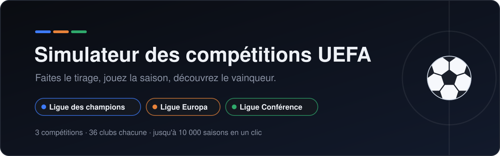
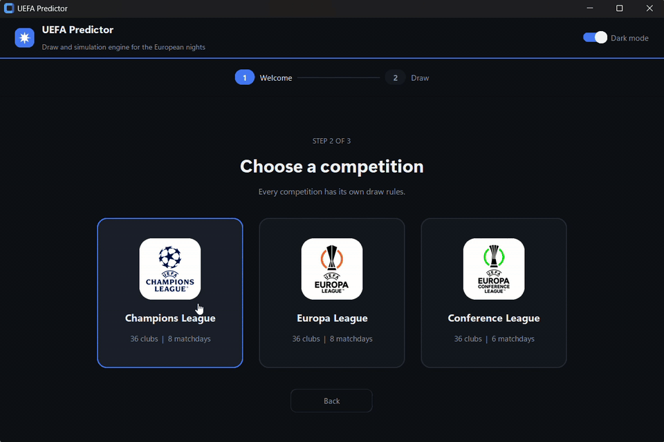
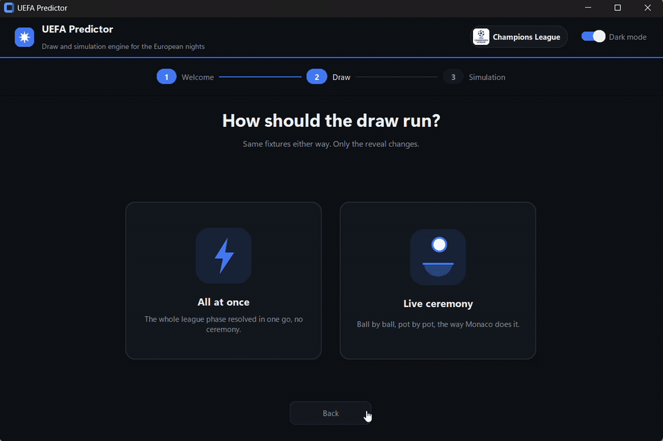
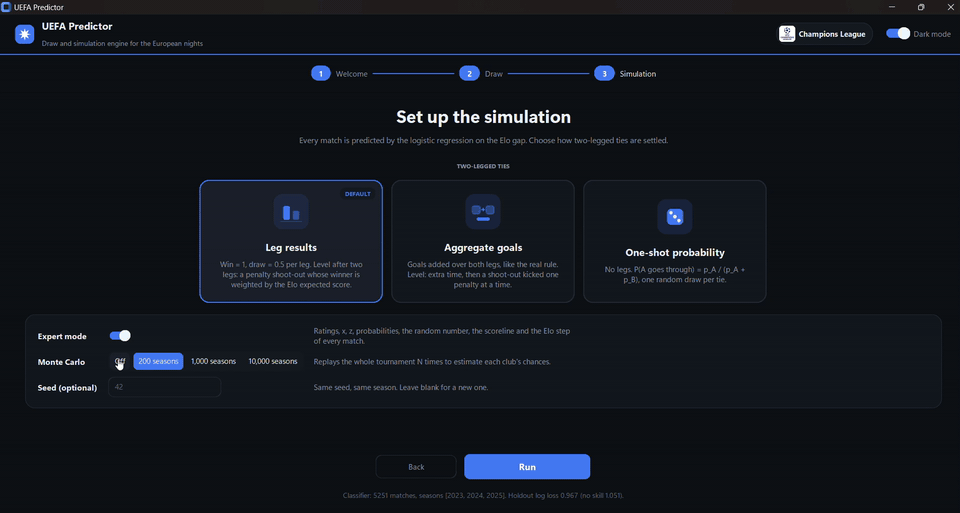
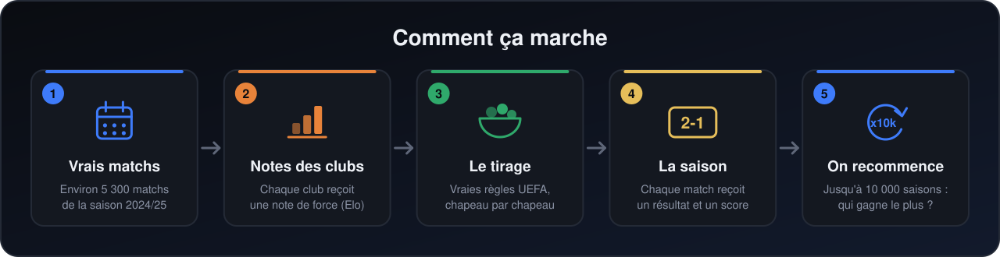
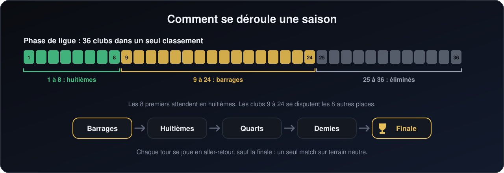

<p align="center">
  
</p>

<p align="center">
  <a href="https://github.com/yassinox12834/UEFA-Competitions-Simulator/releases/latest"></a>
  
  
  
  <a href="LICENCE"></a>
</p>

<p align="center">
  <a href="README.md"><b>🇬🇧 English version</b></a> ·
  <a href="CHANGELOG.md">Journal des modifications</a> ·
  <a href="https://github.com/yassinox12834/UEFA-Competitions-Simulator/issues">Signaler un bug</a>
</p>

<p align="center">
  <a href="https://github.com/yassinox12834/UEFA-Competitions-Simulator/releases/latest/download/UEFA-Simulator-windows.zip">
    
  </a>
</p>

<p align="center">
  <a href="#en-images">En images</a> ·
  <a href="#ce-que-dit-le-modèle">Chances</a> ·
  <a href="#ce-que-vous-pouvez-faire">Fonctions</a> ·
  <a href="#comment-ça-marche">Comment ça marche</a> ·
  <a href="#démarrage-rapide">Démarrage rapide</a> ·
  <a href="#documentation">Docs</a> ·
  <a href="#limites-connues">Limites</a>
</p>

## Qu'est-ce que c'est ?

Une application qui joue pour vous les trois compétitions européennes de clubs : la **Ligue des champions**, la **Ligue Europa** et la **Ligue Conférence**.

Elle fait le tirage avec les vraies règles de l'UEFA, joue chaque match de la saison, et peut rejouer toute la saison **des milliers de fois** pour montrer les vraies chances de chaque club d'aller loin.

## En images

<p align="center">
  <br>
  <sub><b>Le menu.</b> Choisissez une langue, une compétition et un mode.</sub>
</p>

<p align="center">
  <br>
  <sub><b>Le tirage.</b> Chapeau par chapeau, comme la vraie cérémonie.</sub>
</p>

<p align="center">
  <br>
  <sub><b>La simulation.</b> Classement, phases finales, et les chances de chaque club.</sub>
</p>

## Ce que dit le modèle

Chances de gagner le titre avec les vrais chapeaux 2025/26 de la Ligue des champions (un tirage, 10 000 rejeux, version 1.1.0) :

| # | Club | 8 premiers | Quarts | Finale | Titre |
|---|---|---|---|---|---|
| 1 | Barcelona | 68 % | 70 % | 33 % | 20,2 % |
| 2 | Paris Saint-Germain | 67 % | 70 % | 33 % | 20,0 % |
| 3 | Bayern Munich | 55 % | 54 % | 17 % | 8,2 % |
| 4 | Inter Milan | 49 % | 50 % | 15 % | 7,5 % |
| 5 | Liverpool | 46 % | 46 % | 13 % | 6,5 % |
| 6 | Real Madrid | 42 % | 41 % | 10 % | 4,5 % |
| 7 | Arsenal | 37 % | 37 % | 9 % | 3,9 % |
| 8 | Chelsea | 27 % | 33 % | 8 % | 3,8 % |
| 9 | Benfica | 30 % | 34 % | 8 % | 3,5 % |
| 10 | Sporting CP | 33 % | 35 % | 8 % | 3,5 % |

<sub>Un seul tirage (graine 1, chapeaux de `templates/2025_2026/`) : un autre tirage déplace un club d'un point ou deux. Les confrontations aller-retour utilisent la méthode par défaut, « legs ». Les notes viennent d'environ une saison et demie de matchs et sont traitées comme exactes, donc les chances affichées sont un peu trop sûres d'elles. Voir [Limites connues](#limites-connues).</sub>

## Ce que vous pouvez faire

| | |
|---|---|
| 🎱 **Faire le tirage** | Avec les vraies règles : 8 adversaires par club (6 en Ligue Conférence), jamais un club du même pays, au plus 2 d'un même autre pays. |
| 🎬 **Regarder la cérémonie** | Chapeau par chapeau, ou directement le résultat. |
| ✏️ **Changer les clubs** | En mode « Tirage seul » : remplacer n'importe quel club, échanger deux clubs de chapeau avec Ctrl + clic (Cmd + clic sur Mac ; un échange qui rendrait le tirage impossible est refusé), interdire un match (par exemple, Genk ne doit pas recevoir Brann), charger des chapeaux depuis un fichier, ou enregistrer les vôtres. |
| ⚽ **Jouer une saison complète** | Classement, barrages, phases finales et une finale sur terrain neutre. Chaque match a un vrai score ; les tirs au but sont joués tir par tir. |
| 📈 **Suivre la forme** | Un club qui gagne souvent devient plus fort pendant la saison. |
| 🔁 **La rejouer 10 000 fois** | Voir, pour chaque club, à quelle fréquence il atteint chaque tour. |
| 📄 **Lire chaque détail** | Un compte rendu complet de chaque match, dans l'application et dans un fichier texte. |
| 🌍 **À votre façon** | Anglais ou français, thème clair ou sombre. |

Les vrais chapeaux 2025/26 des trois compétitions sont fournis comme modèles dans `templates/2025_2026/`.

## Comment ça marche

<p align="center">
  
</p>

1. **Vrais matchs.** L'application apprend à partir d'environ 4 600 vrais matchs de la saison 2024/25 (amicaux exclus).
2. **Notes des clubs.** À partir de ces résultats, chaque club reçoit une note de force, appelée note Elo. Battre un club fort rapporte plus que battre un club faible.
3. **Le tirage.** Les chapeaux sont tirés avec les mêmes règles que l'UEFA.
4. **La saison.** Pour chaque match, l'application transforme les notes des deux clubs en chances (victoire à domicile, nul, victoire à l'extérieur), puis choisit un résultat et un score.
5. **On recommence.** Une saison, c'est une histoire ; 10 000 saisons donnent de vraies chances.

Chaque étape est expliquée avec des exemples et de petits programmes Python dans [`model/docs/`](model/docs/README.md).

### Comment se déroule une saison

Depuis 2024/25, les trois compétitions ont un nouveau format. Si vous ne l'avez pas suivi, le voici en une image :

<p align="center">
  
</p>

---

## Démarrage rapide

### L'application Windows (sans Python)

1. Ouvrez la [dernière version](https://github.com/yassinox12834/UEFA-Competitions-Simulator/releases/latest/download/UEFA-Simulator-windows.zip) et téléchargez `UEFA-Simulator-windows.zip`.
2. Décompressez-le, ouvrez le dossier, et double-cliquez sur `UEFA-Simulator.exe`.

Windows peut dire que l'éditeur est inconnu, car l'application n'est pas signée : cliquez sur **Informations complémentaires**, puis sur **Exécuter quand même**.

### Depuis le code source

Pour macOS et Linux, ou si vous voulez lire et modifier le code. Il vous faut **Python 3.10 ou plus récent** avec **Tkinter** ; aucune clé d'API.

```bash
git clone https://github.com/yassinox12834/UEFA-Competitions-Simulator.git
cd UEFA-Competitions-Simulator
```

| Système | Une fois : installer les paquets | À chaque fois : lancer l'application |
|---|---|---|
| 🪟 Windows (PowerShell) | `.\commands\windows\req.ps1` | `.\commands\windows\run.ps1` |
| 🍎 macOS | `bash commands/MacOs/req.sh` | `bash commands/MacOs/run.sh` |
| 🐧 Linux | `bash commands/linux/req.sh` | `bash commands/linux/run.sh` |

Choisissez ensuite une langue, une compétition et un mode (tirage seul, ou simulation complète), puis suivez les écrans.

Plusieurs versions de Python, pas de scripts, ou Tkinter absent ? Le [guide d'installation](docs/installation.fr.md) couvre tous les cas. Un message d'erreur ? Voir [en cas de problème](docs/troubleshooting.fr.md).

## Documentation

### Utiliser l'application

| Guide | Ce qu'il couvre |
|---|---|
| [Installation](docs/installation.fr.md) | Ce qu'il vous faut, chaque système, le choix de la version de Python, l'installation à la main, à quoi sert chaque paquet. |
| [Commandes du terminal](docs/terminal.fr.md) | Lancer le tirage et la simulation sans la fenêtre. |
| [En cas de problème](docs/troubleshooting.fr.md) | Chaque message d'erreur connu et que faire. |
| [Créer l'application](docs/building.fr.md) | Créer vous-même l'application Windows, macOS ou Linux avec PyInstaller. |
| [Organisation du projet](docs/project-structure.fr.md) | Ce que contient chaque dossier. |

### Dans le projet

| Où | Ce que vous y trouverez |
|---|---|
| [`model/docs/`](model/docs/README.md) | Le guide du modèle, 12 pages courtes : notes, modèle de match, tirage, journées, noms des clubs, un match, scores, classement, phases finales, prolongation, tirs au but, saisons rejouées. Chacune contient un exemple complet avec de vrais nombres et un petit programme Python à essayer. |
| [`model/docs/code/`](model/docs/code/) | Le code de chaque partie, expliqué quelques lignes à la fois. |
| [`datahandler/`](datahandler/README.md) | D'où viennent les données et comment les télécharger à nouveau. |
| [`templates/`](templates/README.md) | Les fichiers de chapeaux que l'application peut charger et enregistrer. |
| [`interface/`](interface/README.md) | Comment l'interface a été écrite. |
| [Journal des modifications](CHANGELOG.md) | Chaque changement notable, version par version. |

## D'où viennent les données

Toutes les données de matchs viennent d'[API-Football](https://www.api-football.com), avec son offre gratuite : la saison de clubs 2024/25, environ 5 300 matchs (championnats, coupes, matchs européens et amicaux). L'offre gratuite ne donne que les saisons récentes et 100 requêtes par jour ; [`datahandler/`](datahandler/README.md) en dit plus.

## Limites connues

- Les notes viennent d'environ une saison et demie de matchs, donc beaucoup de clubs restent proches de leur note de départ.
- Un résultat ne dépend que des notes des deux clubs : pas de blessures, pas de joueurs, pas de forme récente avant la saison.
- Le score d'un match ne dépend pas de l'écart de force entre les deux clubs.
- Les notes sont considérées comme exactes, donc les chances affichées sont un peu trop sûres d'elles.
- La façon de trancher une confrontation aller-retour par défaut (« legs ») compare les victoires et les nuls, pas les buts : environ 27 % des confrontations vont aux tirs au but, contre environ 10 % dans les vraies données. La méthode « aggregate », la vraie règle, en donne environ 6 %.
- Hamrun Spartans (modèle 2025/26 de la Ligue Conférence) n'a aucun match dans les données et part de la note par défaut, 1500.

## Bugs connus de la version 1.1.0

Aucun ne change beaucoup un résultat. Restent ouverts :

| Bug | Effet |
|---|---|
| Le match retour des quarts et des demies est donné à un club à pile ou face ; depuis 2025/26, l'UEFA le donne aux clubs classés 1 à 4 (1 et 2 en demies) | L'avantage du terrain au retour va parfois au mauvais club |
| Le tableau des quarts (`QF_BRACKET` : 1-8, 3-5, 2-7, 4-6) n'a pas été vérifié avec l'annexe B du règlement de l'UEFA | Le chemin vers la finale peut différer de celui de l'UEFA |
| `datahandler/` : la saison est écrite à la main et les requêtes n'ont pas de délai maximum | Voir [`datahandler/`](datahandler/README.md#problèmes-connus) |

Les dix bugs de la version 1.0.2 sont corrigés. La liste, avec chaque correction, est dans le [journal des modifications](CHANGELOG.md) et dans [`model/docs/`](model/docs/README.md#les-bugs-connus-au-m%C3%AAme-endroit).

## Idées pour la suite

- [ ] Une interface plus facile à modifier.
- [ ] Des données d'autres saisons.
- [ ] La vraie règle qui décide qui reçoit au match retour en quarts et en demies (pile ou face pour l'instant).
- [ ] Une barre de « tension » qui montre à quel point un match est serré.
- [ ] Les joueurs, et une simulation en direct.

## Vos retours

Vous avez trouvé un bug, ou vous avez une idée ? [Ouvrez un ticket](https://github.com/yassinox12834/UEFA-Competitions-Simulator/issues) (une « issue »). Si le projet vous a été utile, une ⭐ aide d'autres personnes à le trouver.

## Licence

MIT, voir [LICENCE](LICENCE).
