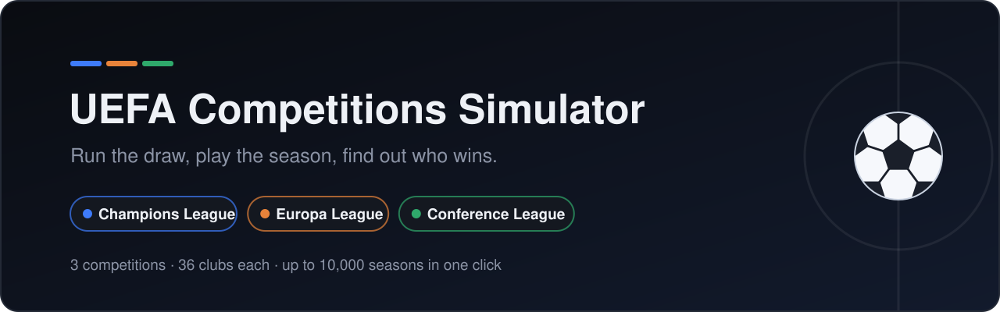
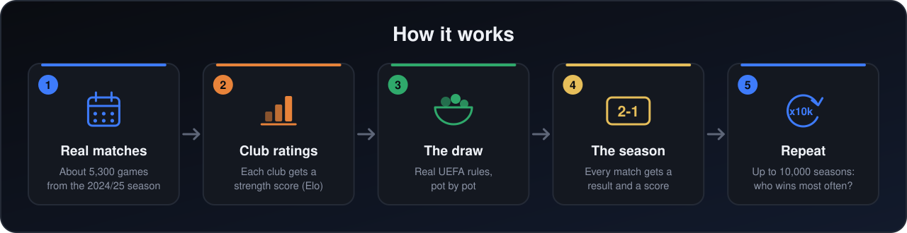
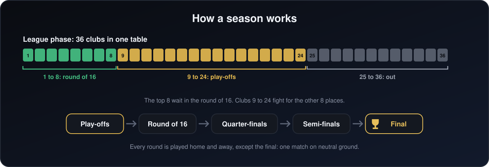

<p align="center">
  
</p>

<p align="center">
  <a href="https://github.com/yassinox12834/UEFA-Competitions-Simulator/releases/latest"></a>
  
  
  
  <a href="LICENSE"></a>
</p>

<p align="center">
  <a href="README.fr.md"><b>🇫🇷 Version française</b></a> ·
  <a href="CHANGELOG.md">Changelog</a> ·
  <a href="https://github.com/yassinox12834/UEFA-Competitions-Simulator/issues">Report a bug</a>
</p>

<p align="center">
  <a href="https://github.com/yassinox12834/UEFA-Competitions-Simulator/releases/latest">
    
  </a>
</p>

<p align="center">
  <a href="#see-it-in-action">See it</a> ·
  <a href="#what-the-model-says">Odds</a> ·
  <a href="#what-you-can-do">Features</a> ·
  <a href="#how-it-works">How it works</a> ·
  <a href="#quick-start">Quick start</a> ·
  <a href="#documentation">Docs</a> ·
  <a href="#known-limits">Limits</a>
</p>

## What is it?

A desktop app that plays the three European club competitions for you: the **Champions League**, the **Europa League** and the **Conference League**.

It runs the draw with the real UEFA rules, plays every match of the season, and can replay the whole season **thousands of times** to show each club's real chances of going far.

## See it in action

<p align="center">
  <br>
  <sub><b>The menu.</b> Pick a language, a competition and a mode.</sub>
</p>

<p align="center">
  <br>
  <sub><b>The draw.</b> Played out pot by pot, like the real ceremony.</sub>
</p>

<p align="center">
  <br>
  <sub><b>The simulation.</b> League table, knockout rounds, and each club's chances.</sub>
</p>

## What the model says

Title odds for the real 2025/26 Champions League pots (one draw, 10,000 replays):

| # | Club | Top 8 | Quarter-final | Final | Win |
|---|---|---|---|---|---|
| 1 | Paris Saint-Germain | 73% | 73% | 35% | 21.7% |
| 2 | Barcelona | 64% | 67% | 29% | 16.4% |
| 3 | Inter Milan | 61% | 61% | 21% | 10.0% |
| 4 | Bayern Munich | 46% | 53% | 17% | 8.8% |
| 5 | Liverpool | 49% | 51% | 15% | 7.3% |
| 6 | Real Madrid | 53% | 48% | 12% | 5.8% |
| 7 | Arsenal | 41% | 43% | 11% | 5.1% |
| 8 | Atlético Madrid | 39% | 39% | 8% | 3.8% |
| 9 | Aston Villa | 25% | 33% | 8% | 3.5% |
| 10 | Benfica | 39% | 35% | 6% | 2.6% |

<sub>One draw only (seed 1): another draw moves a club by a point or two. The ratings come from about a season and a half of matches and are treated as exact, so the chances are a little too sure of themselves. See [Known limits](#known-limits).</sub>

## What you can do

| | |
|---|---|
| 🎱 **Run the draw** | With the real rules: 8 opponents per club (6 in the Conference League), never a club from the same country, at most 2 from any other country. |
| 🎬 **Watch the ceremony** | Pot by pot, or skip straight to the result. |
| ✏️ **Change the clubs** | Replace any club, ban a match you do not want (for example, Genk must not play at home against Brann), load pots from a file, or save your own. |
| ⚽ **Play a full season** | League table, play-offs, knockout rounds and a final on neutral ground. Every match gets a real score; penalty shoot-outs are played kick by kick. |
| 📈 **Follow the form** | A club that keeps winning gets stronger during the season. |
| 🔁 **Replay it 10,000 times** | See, for each club, how often it reaches each round. |
| 📄 **Read every detail** | A full report of every match, in the app and as a text file. |
| 🌍 **Your way** | English or French, light or dark theme. |

The real 2025/26 pots of all three competitions are already included.

## How it works

<p align="center">
  
</p>

1. **Real matches.** The app learns from about 5,300 real games of the 2024/25 season.
2. **Club ratings.** From those results, every club gets a strength score, called an Elo rating. Beating a strong club earns more than beating a weak one.
3. **The draw.** The pots are drawn with the same rules UEFA uses.
4. **The season.** For each match, the app turns the two clubs' ratings into chances (home win, draw, away win), then picks a result and a score.
5. **Repeat.** One season is a story; 10,000 seasons give real chances.

Each step is explained with examples and small Python programs in [`model/docs/`](model/docs/README.md).

### How a season works

Since 2024/25, the three competitions use a new format. If you have not followed it, here it is in one picture:

<p align="center">
  
</p>

---

## Quick start

### The Windows app (no Python needed)

1. Open the [latest release](https://github.com/yassinox12834/UEFA-Competitions-Simulator/releases/latest) and download `UEFA-Simulator-windows.zip`.
2. Unzip it, open the folder, and double-click `UEFA-Simulator.exe`.

Windows may say the publisher is unknown, because the app is not signed: click **More info**, then **Run anyway**.

### From the source code

For macOS and Linux, or if you want to read and change the code. You need **Python 3.10 or newer** with **Tkinter**; no API key.

```bash
git clone https://github.com/yassinox12834/UEFA-Competitions-Simulator.git
cd UEFA-Competitions-Simulator
```

| System | Once: install the packages | Every time: launch the app |
|---|---|---|
| 🪟 Windows (PowerShell) | `.\commands\windows\req.ps1` | `.\commands\windows\run.ps1` |
| 🍎 macOS | `bash commands/MacOs/req.sh` | `bash commands/MacOs/run.sh` |
| 🐧 Linux | `bash commands/linux/req.sh` | `bash commands/linux/run.sh` |

Then pick a language, a competition and a mode (draw only, or full simulation), and follow the screens.

Several Python versions, no scripts, or Tkinter missing? The [installation guide](docs/installation.md) covers every case. An error message? See [troubleshooting](docs/troubleshooting.md).

## Documentation

### Using the app

| Guide | What it covers |
|---|---|
| [Installation](docs/installation.md) | What you need, every system, choosing your Python version, installing by hand, what each package is for. |
| [Terminal commands](docs/terminal.md) | Running the draw and the simulation without the window. |
| [Troubleshooting](docs/troubleshooting.md) | Every known error message and what to do about it. |
| [Building the app](docs/building.md) | Making the Windows, macOS or Linux app yourself with PyInstaller. |
| [Project structure](docs/project-structure.md) | What each folder holds. |

### Inside the project

| Where | What you will find |
|---|---|
| [`model/docs/`](model/docs/README.md) | The guide to the model, 12 short pages: ratings, match model, draw, matchdays, club names, one match, scores, league table, knockout, extra time, penalties, replaying the season. Each has a full example with real numbers and a small Python program to try. |
| [`model/docs/code/`](model/docs/code/) | The code of each part, explained a few lines at a time. |
| [`datahandler/`](datahandler/README.md) | Where the data comes from and how to download it again. |
| [`templates/`](templates/README.md) | The pot files the app can load and save. |
| [`interface/`](interface/README.md) | How the interface was written. |
| [Changelog](CHANGELOG.md) | Every notable change, version by version. |

## Where the data comes from

All match data comes from [API-Football](https://www.api-football.com), on its free plan: the 2024/25 club season, about 5,300 matches (leagues, cups, European games and friendlies). The free plan only gives recent seasons and 100 requests a day; [`datahandler/`](datahandler/README.md) explains more.

## Known limits

- The ratings come from about a season and a half of matches, so many clubs stay close to their starting value.
- A result depends only on the two clubs' ratings: no injuries, no players, no recent form before the season.
- The score of a match does not depend on how much stronger the winner is.
- The ratings are treated as exact, so the chances shown are a little too sure of themselves.

The full list, with every known bug, is in [`model/docs/`](model/docs/README.md#known-bugs-all-in-one-place).

## Ideas for later

- [ ] An interface that is easier to change.
- [ ] Data from other seasons.
- [ ] The real rule for who plays the second leg at home in the quarter-finals and semi-finals (a coin toss for now).
- [ ] A "tension" bar that shows how tight a match is.
- [ ] Players, and a live simulation.

## Feedback

Found a bug, or have an idea? [Open an issue](https://github.com/yassinox12834/UEFA-Competitions-Simulator/issues). If the project was useful to you, a ⭐ helps other people find it.

## Licence

MIT, see [LICENSE](LICENSE).
