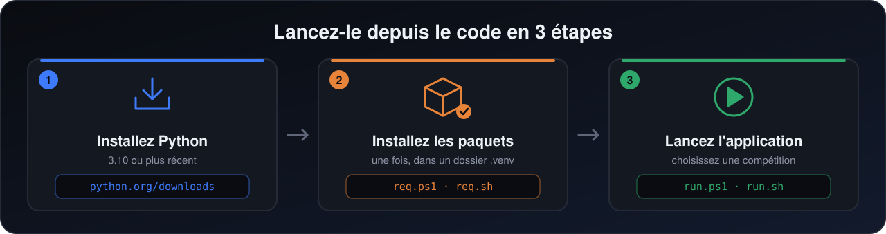

<sub>[← README](../README.fr.md) · **Installation** · [Terminal](terminal.fr.md) · [Problèmes](troubleshooting.fr.md) · [Créer l'application](building.fr.md) · [Organisation](project-structure.fr.md) · [🇬🇧 English](installation.md)</sub>

# Installation

Deux façons de lancer le simulateur : l'application Windows toute prête, ou le code source sur n'importe quel système.

- [L'application Windows](#lapplication-windows)
- [Depuis le code source](#depuis-le-code-source)
  - [Ce qu'il vous faut](#ce-quil-vous-faut)
  - [Récupérer le code](#récupérer-le-code)
  - [Windows (PowerShell)](#windows-powershell)
  - [Windows, en choisissant votre version de Python](#windows-en-choisissant-votre-version-de-python)
  - [macOS](#macos)
  - [Linux](#linux)
  - [À la main, sans les scripts](#à-la-main-sans-les-scripts)
- [À quoi sert chaque paquet](#à-quoi-sert-chaque-paquet)

## L'application Windows

Sans Python.

1. Ouvrez la [dernière version](https://github.com/yassinox12834/UEFA-Competitions-Simulator/releases/latest) et téléchargez `UEFA-Simulator-windows.zip`.
2. Décompressez-le, ouvrez le dossier, et double-cliquez sur `UEFA-Simulator.exe`.

Windows peut dire que l'éditeur est inconnu, car l'application n'est pas signée : cliquez sur **Informations complémentaires**, puis sur **Exécuter quand même**.

Les chapeaux que vous enregistrez et les comptes rendus vont dans `C:\Users\<vous>\UEFA-Simulator\`.

## Depuis le code source

Pour macOS et Linux, ou si vous voulez lire et modifier le code.

<p align="center">
  
</p>

### Ce qu'il vous faut

- **Python 3.10 ou plus récent.** Vérifiez avec `python --version` (`python3 --version` sur macOS et Linux).
- **Tkinter**, qui dessine la fenêtre. Il est inclus dans les installateurs de [python.org](https://www.python.org/downloads/) sur Windows et macOS. Sur Debian ou Ubuntu : `sudo apt install python3-tk python3-venv`. Il ne s'installe pas avec `pip`.
- **Aucune clé d'API.** Tout ce dont l'application a besoin est déjà dans le projet. Une clé ne sert qu'à télécharger de nouvelles données (voir [`datahandler/`](../datahandler/README.md)).

### Récupérer le code

```bash
git clone https://github.com/yassinox12834/UEFA-Competitions-Simulator.git
cd UEFA-Competitions-Simulator
```

Suivez ensuite la partie de votre système. Chaque script se place d'abord dans le dossier du projet, il fonctionne donc depuis n'importe où. Le script `req` installe les paquets dans un dossier `.venv` du projet, et `run` l'utilise tout seul : rien à activer.

### Windows (PowerShell)

```powershell
.\commands\windows\req.ps1      # une fois : installer les paquets
.\commands\windows\run.ps1      # à chaque fois : lancer l'application
```

Si PowerShell dit que l'exécution de scripts est désactivée, tapez une fois ceci dans cette fenêtre, puis réessayez :

```powershell
Set-ExecutionPolicy -Scope Process RemoteSigned
```

### Windows, en choisissant votre version de Python

Pour ceux qui ont plusieurs versions de Python et veulent en choisir une avec `py`. Ces scripts installent les paquets directement pour cette version, sans `.venv`.

1. Tapez `py --list` pour voir les versions installées sur votre ordinateur.
2. Ouvrez [`commands/python manager/version.ps1`](../commands/python%20manager/version.ps1) et remplacez `3.12` par l'une d'elles (3.10 ou plus récente). C'est la seule ligne à changer : les trois scripts la lisent là.
3. Lancez-les. Le chemin contient un espace, il faut donc des guillemets et un `&` devant :

```powershell
& ".\commands\python manager\req.ps1"      # une fois
& ".\commands\python manager\run.ps1"      # à chaque fois
```

Si la version écrite n'est pas installée, le script le dit et affiche celles que vous avez.

### macOS

```bash
bash commands/MacOs/req.sh      # une fois : installer les paquets
bash commands/MacOs/run.sh      # à chaque fois : lancer l'application
```

Si vous avez installé Python avec Homebrew, Tkinter est à part : `brew install python-tk`.

### Linux

```bash
sudo apt install python3-tk python3-venv   # Debian ou Ubuntu, une fois
bash commands/linux/req.sh                 # une fois : installer les paquets
bash commands/linux/run.sh                 # à chaque fois : lancer l'application
```

### À la main, sans les scripts

```bash
# 1. Créer un environnement virtuel et l'activer
py -m venv .venv                 # Windows
.venv\Scripts\Activate.ps1       # Windows : "(.venv)" s'affiche au début de la ligne

python3 -m venv .venv            # macOS ou Linux
source .venv/bin/activate        # macOS ou Linux

# 2. Installer les paquets, puis lancer
python -m pip install -r requirements.txt
python main.py
```

Toutes les commandes se lancent depuis le dossier du projet, celui qui contient `main.py`.

Une fois l'application ouverte, choisissez une langue, une compétition et un mode (tirage seul, ou simulation complète), puis suivez les écrans. Quelque chose ne va pas ? Voir [en cas de problème](troubleshooting.fr.md).

## À quoi sert chaque paquet

| Paquet | À quoi il sert |
|---|---|
| `customtkinter` | la fenêtre et tous les écrans |
| `Pillow` | les écussons des clubs et les drapeaux |
| `pandas`, `numpy` | recalculer les notes à partir des vrais matchs (l'application elle-même n'en a pas besoin) |
| `scikit-learn` | réentraîner le modèle de match (l'application lit seulement ses 8 nombres enregistrés) |
| `requests`, `python-dotenv` | télécharger de nouvelles données depuis API-Football |
