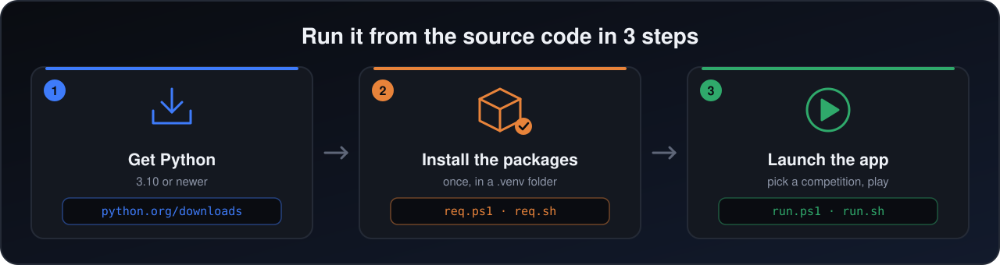

<sub>[← README](../README.md) · **Installation** · [Terminal](terminal.md) · [Troubleshooting](troubleshooting.md) · [Building](building.md) · [Structure](project-structure.md) · [🇫🇷 Français](installation.fr.md)</sub>

# Installation

Two ways to run the simulator: the ready-made Windows app, or the source code on any system.

- [The Windows app](#the-windows-app)
- [From the source code](#from-the-source-code)
  - [What you need](#what-you-need)
  - [Get the code](#get-the-code)
  - [Windows (PowerShell)](#windows-powershell)
  - [Windows, choosing your Python version](#windows-choosing-your-python-version)
  - [macOS](#macos)
  - [Linux](#linux)
  - [By hand, without the scripts](#by-hand-without-the-scripts)
- [What each package is for](#what-each-package-is-for)

## The Windows app

No Python needed.

1. Open the [latest release](https://github.com/yassinox12834/UEFA-Competitions-Simulator/releases/latest) and download `UEFA-Simulator-windows.zip`.
2. Unzip it, open the folder, and double-click `UEFA-Simulator.exe`.

Windows may say the publisher is unknown, because the app is not signed: click **More info**, then **Run anyway**.

The pots you save and the match reports go to `C:\Users\<you>\UEFA-Simulator\`.

## From the source code

For macOS and Linux, or if you want to read and change the code.

<p align="center">
  
</p>

### What you need

- **Python 3.10 or newer.** Check with `python --version` (`python3 --version` on macOS and Linux).
- **Tkinter**, which draws the window. It comes with the installers from [python.org](https://www.python.org/downloads/) on Windows and macOS. On Debian or Ubuntu: `sudo apt install python3-tk python3-venv`. It cannot be installed with `pip`.
- **No API key.** Everything the app needs is already in the project. A key is only needed to download new data (see [`datahandler/`](../datahandler/README.md)).

### Get the code

```bash
git clone https://github.com/yassinox12834/UEFA-Competitions-Simulator.git
cd UEFA-Competitions-Simulator
```

Then follow the section for your system. Each script first moves to the project folder, so it works from anywhere. The `req` script puts the packages in a `.venv` folder inside the project, and `run` uses it automatically: nothing to activate.

### Windows (PowerShell)

```powershell
.\commands\windows\req.ps1      # once: install the packages
.\commands\windows\run.ps1      # every time: launch the app
```

If PowerShell says that running scripts is disabled, type this once in that window, then try again:

```powershell
Set-ExecutionPolicy -Scope Process RemoteSigned
```

### Windows, choosing your Python version

Use these if you have several versions of Python and want to pick one with `py`. They install the packages for that version directly, without a `.venv`.

1. Type `py --list` to see the versions installed on your computer.
2. Open [`commands/python manager/version.ps1`](../commands/python%20manager/version.ps1) and replace `3.12` with one of them (3.10 or newer). It is the only line to change: the three scripts read it from there.
3. Run them. The path has a space, so it needs quotes and `&` in front:

```powershell
& ".\commands\python manager\req.ps1"      # once
& ".\commands\python manager\run.ps1"      # every time
```

If the version you wrote is not installed, the script says so and lists the ones you have.

### macOS

```bash
bash commands/MacOs/req.sh      # once: install the packages
bash commands/MacOs/run.sh      # every time: launch the app
```

If you installed Python with Homebrew, Tkinter is separate: `brew install python-tk`.

### Linux

```bash
sudo apt install python3-tk python3-venv   # Debian or Ubuntu, once
bash commands/linux/req.sh                 # once: install the packages
bash commands/linux/run.sh                 # every time: launch the app
```

### By hand, without the scripts

```bash
# 1. Create a virtual environment and activate it
py -m venv .venv                 # Windows
.venv\Scripts\Activate.ps1       # Windows: "(.venv)" appears at the start of the line

python3 -m venv .venv            # macOS or Linux
source .venv/bin/activate        # macOS or Linux

# 2. Install the packages, then launch
python -m pip install -r requirements.txt
python main.py
```

Every command runs from the project folder, the one that contains `main.py`.

Once the app is open, pick a language, a competition and a mode (draw only, or full simulation), and follow the screens. Something went wrong? See [troubleshooting](troubleshooting.md).

## What each package is for

| Package | What it is for |
|---|---|
| `customtkinter` | the window and every screen |
| `Pillow` | the club badges and flags |
| `pandas`, `numpy` | rebuilding the ratings from the real matches (the app itself does not need them) |
| `scikit-learn` | training the match model again (the app only reads its 8 saved numbers) |
| `requests`, `python-dotenv` | downloading new data from API-Football |
