# The match model: from a rating gap to three chances

> Give this model the ratings of two clubs, and it gives back three chances: the home side wins, it is a draw, the away side wins. It learnt how to do this from 5 251 real European matches. Its proper name is a **multinomial logistic regression**; by section 7 you will know what each of those words means.

*Version française : [plus bas](#le-modèle-de-match--dun-écart-de-notes-à-trois-chances).*

## In short

- **What goes in:** two Elo ratings, for example Arsenal 1787.88 at home against Atalanta 1720.12 (ratings are explained in [`elo.md`](elo.md)).
- **What comes out:** three chances that add up to 100 %, for example 62.2 % home win, 19.4 % draw, 18.4 % away win.
- **Where it is used:** before every simulated match, to decide how likely each result is.
- **Code:** `model/predictor.py`. Line-by-line walkthrough: [`code/predictor_code.md`](code/predictor_code.md).

**How to read this page.** Sections 1 to 14 tell the story with numbers you can check on a calculator; no maths beyond that is needed. Sections 15 to 17 are for people who work on the code.

**Before you start**, you only need three things:

| You need | Quick test | If not |
|---|---|---|
| what an Elo rating is | A club rated 1800 plays a club rated 1700. Which is stronger, and by how much? | [`elo.md`](elo.md), sections 2 and 3 |
| percentages | A forecast says "70 % chance of rain". On how many days out of 10 like this should it rain? | [Maths is Fun: probability](https://www.mathsisfun.com/data/probability.html) |
| the $e^x$ button of a calculator | Type $e^1$: about 2.718? Type $e^{-1}$: about 0.368? | [Maths is Fun: the number e](https://www.mathsisfun.com/numbers/e-eulers-number.html) |

---

## 1. The question

Arsenal play Atalanta at home. Arsenal are rated 1787.88, Atalanta 1720.12. Who wins?

Nobody knows. Football is full of luck: a deflected shot, a red card, a goalkeeper having the night of his life. What we *can* give is something like a weather forecast:

> "Arsenal win about 62 times out of 100, draw about 19 times, lose about 18 times."

That is what this model produces: **three chances**, one per result, that always add up to 100 %.

Why not simply pick a winner? Because the simulation does not want one answer: it wants to **roll a die**. It plays every match of the competition, then replays the whole competition hundreds of times. If Arsenal always won, Atalanta would never have a lucky night, and real football is full of lucky nights.

So the whole page answers one question:

> **How do you turn "Arsenal are 67.76 points stronger" into "62 % / 19 % / 18 %"?**

---

## 2. What the real matches say

Before building anything, look at the data: 5 251 real matches, put into groups by rating gap. The **gap** is the home club's rating minus the away club's rating, so a positive gap means the home side is stronger.

| Rating gap | Matches | Home wins | Draws | Away wins |
|---|---:|---:|---:|---:|
| −300 to −150 (home side much weaker) | 260 | 15.8 % | 16.9 % | 67.3 % |
| −150 to −100 | 437 | 17.2 % | 23.1 % | 59.7 % |
| −100 to −50 | 785 | 26.9 % | 22.3 % | 50.8 % |
| −50 to −20 | 590 | 34.6 % | 21.7 % | 43.7 % |
| −20 to +20 (about equal) | 1 114 | 45.1 % | 23.5 % | 31.4 % |
| +20 to +50 | 614 | 58.3 % | 20.4 % | 21.3 % |
| +50 to +100 | 748 | 66.4 % | 19.0 % | 14.6 % |
| +100 to +150 | 448 | 72.1 % | 16.5 % | 11.4 % |
| +150 to +300 (home side much stronger) | 255 | 77.3 % | 12.2 % | 10.6 % |

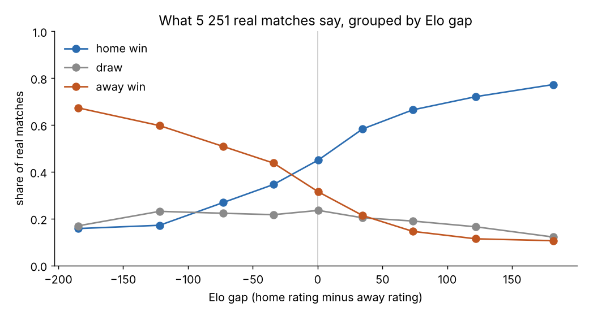

Three things stand out, and the whole model is built on them:

1. **The stronger the home side, the more it wins**: from 16 % to 77 %.
2. **Draws hardly care about the gap.** They stay around 20 %, a bit lower when one side is much stronger.
3. **Look at the middle row.** When the clubs are equal, the home side wins 45 % and the away side only 31 %. That is **home advantage**. It comes back in section 9.

Why not just use this table? For Arsenal v Atalanta (gap +67.76) we would read the "+50 to +100" row: 66 / 19 / 15. Not bad, but:

- a gap of +51 and a gap of +99 get **the same answer**, although +99 is clearly stronger;
- a gap of +350 has **no row at all**;
- each row is a bit noisy: the "−150 to −100" row has *more* draws than its neighbours, probably by luck.

We want a **smooth curve** that follows the table, works for any gap and ignores the noise. Building that curve is what "fitting a model" means.

---

## 3. The first idea, and why it fails

The simplest smooth line is a straight line. The best straight line through the home-win column is:

$$\text{chance of a home win} = 0.459 + 0.00214 \times \text{gap}$$

Read it like a recipe: start at 45.9 %, then add 0.214 % for every rating point of gap.

| Gap | What the line says |
|---|---|
| +100 | 67.3 % (fine) |
| +300 | 110 % (impossible) |
| −400 | −40 % (a negative chance?) |

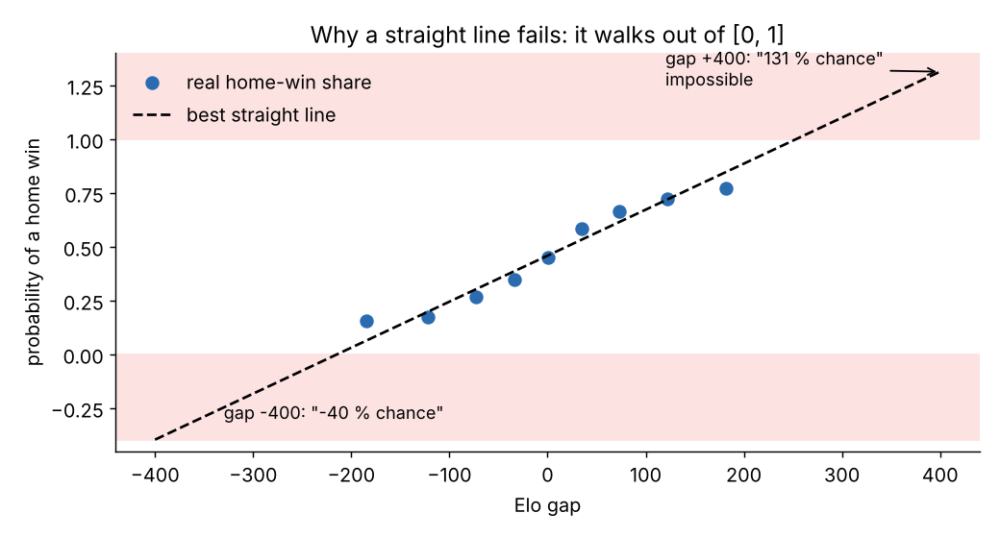

A chance must stay between 0 % and 100 %. A straight line never stops climbing, so sooner or later it goes out of that range. We need something that **bends**: steep in the middle, flat near 0 % and near 100 %. The next steps build exactly that.

---

## 4. Step 0: measure the gap in "typical gaps"

First, the model changes the **unit** of the gap. Instead of "67.76 rating points", it asks "how many **typical gaps** is that?".

In the data, a typical gap is 88.50 points (about two matches in three have a gap between −88.5 and +88.5), and the average gap is almost exactly 0 (−0.15). So:

$$x' = \frac{\text{gap} - \text{average gap}}{\text{typical gap}} = \frac{\text{gap} + 0.15}{88.50}$$

$x'$ (said "x prime") is the gap measured in typical gaps. It is called the **standardised gap**.

| Gap in rating points | Standardised gap $x'$ | In words |
|---:|---:|---|
| 0 | 0.002 | two equal clubs |
| +67.76 (Arsenal v Atalanta) | 0.767 | three quarters of a typical gap |
| +100 | 1.132 | a bit more than one typical gap |
| +283.34 (Barcelona v Girona) | 3.203 | three typical gaps: a huge mismatch |

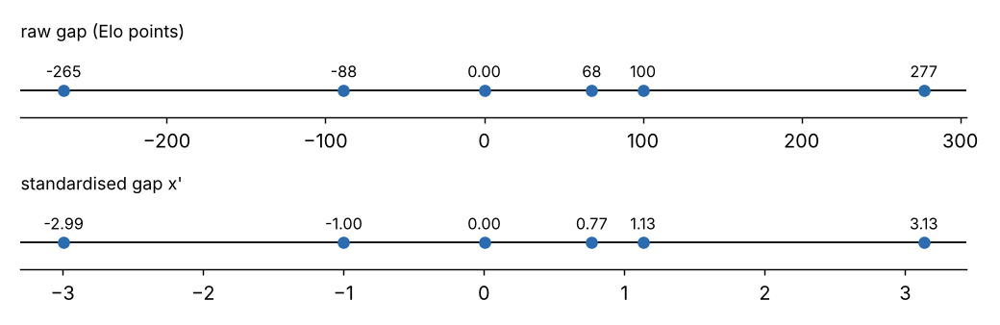

It is like saying "he is two heads taller" instead of "he is 46 cm taller": same fact, different ruler. Nothing is lost.

Two rules come with it:

- The average and the typical gap are **measured once, on the training matches**, then saved and reused for every prediction. If they were measured again on new matches, the ruler would change between learning and using.
- Changing the ruler never changes what the model *can* say, only how fast and how fairly it learns (section 10.4 explains why).

> **With only one input, why bother?** The model has one input, the rating gap, so this step changes almost nothing. It comes from an earlier version that had two inputs (the gap, and a "home" flag of 0 or 1); with several inputs, putting them all on the same ruler matters a lot. It may be removed from the code one day, but it stays in this page because any future version with more inputs needs it.

---

## 5. Step 1: give each result a score

Here is the trick, in two steps. The first step forgets about chances completely.

Imagine three judges. One defends "home win", one "draw", one "away win". Each judge looks at the standardised gap and calls out a **score**: any number, big, small or negative. A bigger score means "I believe in my result more".

Each judge uses their own straight line (a straight line is fine here, because a score is allowed to be any number):

$$\text{score} = \text{slope} \times x' + \text{starting value}$$

| Judge | Slope | Starting value (score at gap 0) | Score at gap +100 | What it means |
|---|---:|---:|---:|---|
| home | +0.569 | +0.356 | +1.000 | a stronger home side makes this judge louder |
| draw | −0.031 | −0.346 | −0.381 | the gap barely moves this judge |
| away | −0.538 | −0.010 | −0.620 | a stronger home side makes this judge quieter |

The slopes and starting values are learnt from the data (section 10). The starting value is often called the **intercept**.

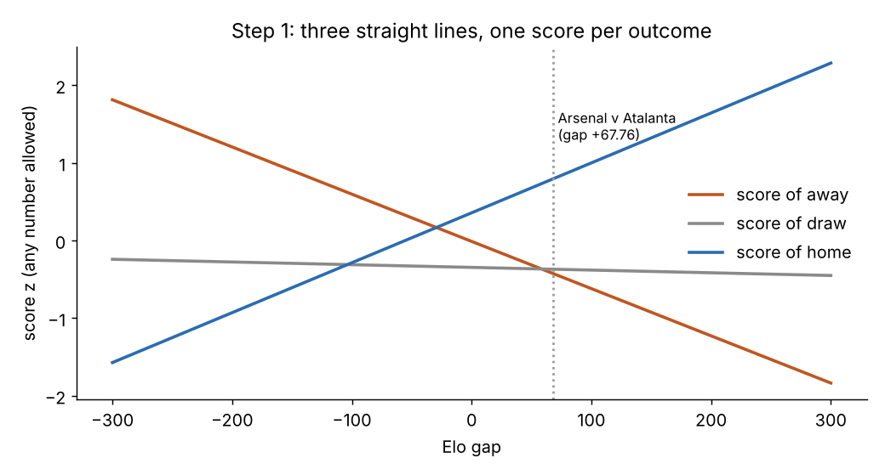

For Arsenal v Atalanta ($x' = 0.767$):

| | home | draw | away |
|---|---:|---:|---:|
| score | **+0.793** | **−0.369** | **−0.423** |

The home judge is loudest. Good: Arsenal are stronger and at home. But "+0.793" is not a chance yet.

> In machine learning, these scores are called **logits**. Same thing, longer name.

---

## 6. Step 2: turn scores into chances (softmax)

### 6.1 The obvious idea breaks

"Divide each score by the total." Try it on three made-up scores, 2, −1 and 0.5. The total is 1.5, so the shares are 133 %, −67 % and 33 %. Broken: a negative score gives a negative chance. Every score must become **positive first**, without changing which one is biggest.

### 6.2 The fix: use $e^x$ first

The function $e^x$ (a button on your calculator) has two useful properties:

- it is **always positive**: $e^{2} = 7.389$, $e^{0} = 1$, $e^{-1} = 0.368$, $e^{-10} = 0.0000454$;
- it **keeps the order**: a bigger score always gives a bigger result.

So: first $e^x$ of each score, *then* divide by the total.

| | score | $e^{\text{score}}$ | share of the total |
|---|---:|---:|---:|
| A | 2 | 7.389 | 7.389 / 9.406 = 78.6 % |
| B | −1 | 0.368 | 0.368 / 9.406 = 3.9 % |
| C | 0.5 | 1.649 | 1.649 / 9.406 = 17.5 % |
| **total** | | **9.406** | **100 %** |

All positive, total 100 %, and the biggest score still wins. This two-move recipe ("$e^x$, then divide by the total") is called **softmax**:

$$\text{chance of a result} = \frac{e^{\text{its score}}}{e^{\text{score home}} + e^{\text{score draw}} + e^{\text{score away}}}$$

### 6.3 Softmax on Arsenal v Atalanta

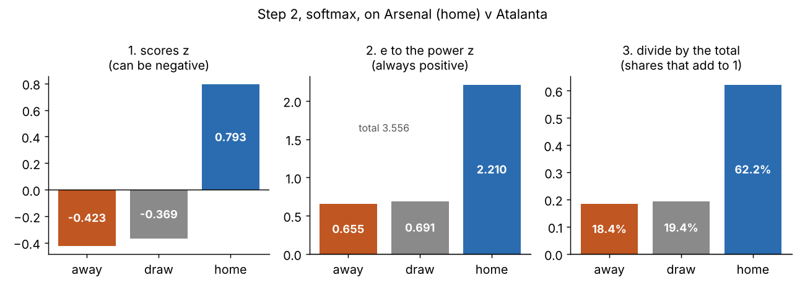

| | home | draw | away | total |
|---|---:|---:|---:|---:|
| score | 0.793 | −0.369 | −0.423 | |
| $e^{\text{score}}$ | 2.210 | 0.691 | 0.655 | 3.556 |
| divide by 3.556 | **62.2 %** | **19.4 %** | **18.4 %** | 100 % |

That is the forecast of section 1. The whole model is just these two steps: three straight lines, then softmax.

### 6.4 A strange but useful fact

Add 10 to every score (12, 9 and 10.5 instead of 2, −1 and 0.5), and softmax gives exactly the same 78.6 %, 3.9 %, 17.5 %.

Why? Adding 10 to a score multiplies its $e^x$ by the same number ($e^{10}$), at the top and at the bottom of every fraction, so it cancels. **Only the differences between scores matter.** The code uses this to avoid a crash: it subtracts the biggest score from all three before using $e^x$, because $e^{710}$ is too big for a computer to store.

---

## 7. So what is this model called?

### 7.1 "Logistic regression": the two-result version

Imagine a sport with no draws, like tennis. Softmax then has only two scores to share out, and it simplifies to:

$$\text{chance of a win} = \frac{1}{1 + e^{-d}} \qquad d = \text{score of "win"} - \text{score of "lose"}$$

| $d$ | −2 | −1 | 0 | +1 | +2 |
|---|---:|---:|---:|---:|---:|
| chance of a win | 11.9 % | 26.9 % | 50.0 % | 73.1 % | 88.1 % |

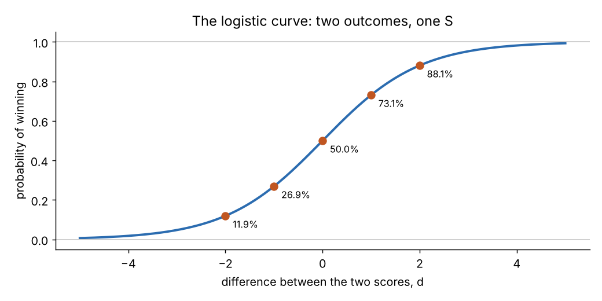

That S-shaped curve, flat at both ends and steep in the middle, is the **logistic curve** (also called the **sigmoid**). A model that draws a straight line and then pushes it through this curve is a **logistic regression**. Elo's expected score is this same curve ([`elo.md`](elo.md), section 3).

### 7.2 "Multinomial": because football has three results

Football has a third result, the draw. **Multinomial** means "with several categories". A **multinomial logistic regression** gives one score to each category and shares them out with softmax, exactly as in sections 5 and 6. It is also called **softmax regression**.

**So the precise name of this model is: a multinomial logistic regression with three classes (away win, draw, home win) and one input (the standardised gap).**

### 7.3 The other way, not used here

A lazier way to handle three results is to train three separate yes/no models: "home win, yes or no?", "draw, yes or no?", "away win, yes or no?". This is called **one-vs-rest**. Each model is trained alone, and nothing forces their answers to agree:

| Gap | "home win?" | "draw?" | "away win?" | **Total** |
|---:|---:|---:|---:|---:|
| +67.76 | 61.9 % | 19.2 % | 18.6 % | **99.8 %** |
| +200 | 86.0 % | 16.8 % | 5.8 % | **108.6 %** |
| −200 | 9.9 % | 24.9 % | 76.9 % | **111.6 %** |

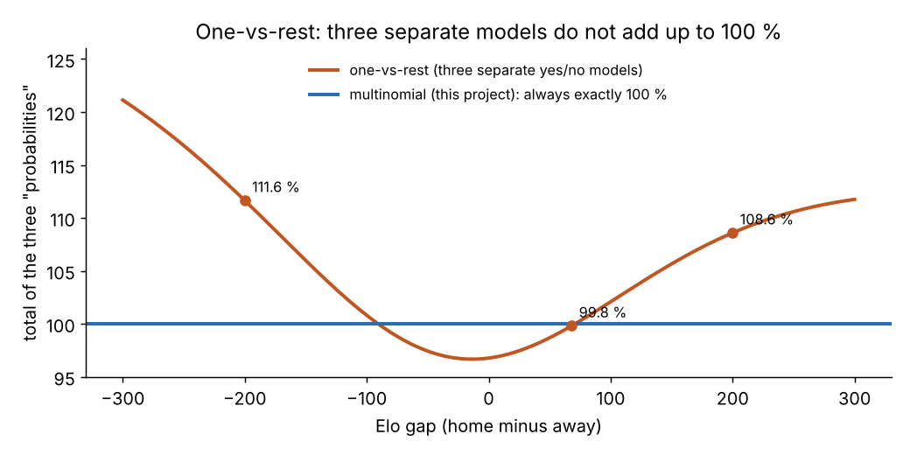

The totals drift away from 100 %. The multinomial version learns the three scores **together**, through one softmax, so the total is always exactly 100 %.

### 7.4 Two results against three: what changes

| | Two results (yes/no) | Three results (this project) |
|---|---|---|
| Input | the standardised gap $x'$ | the same: **nothing changes** |
| Numbers learnt | 1 slope, 1 starting value | 3 slopes, 3 starting values |
| Scores | one | three |
| Turn scores into chances | the S-curve (sigmoid) | softmax |
| Output | 1 chance (the other is 100 % minus it) | 3 chances that add up to 100 % |
| Surprise of a blind guess (section 10) | 0.693 | 1.099 |

In one sentence: going from two results to three changes the number of judges (one to three) and the way scores become chances (S-curve to softmax); the input and the ruler stay the same.

---

## 8. The whole machine, on five real matches

```
ratings  ->  gap  ->  standardised gap  ->  three scores  ->  softmax  ->  three chances
1787.88 v 1720.12   67.76      0.767        0.793 / -0.369 / -0.423      62.2 % / 19.4 % / 18.4 %
```

| Match (home first) | Ratings | Gap | Home win | Draw | Away win |
|---|---|---:|---:|---:|---:|
| Barcelona v Girona | 1841.33 v 1557.99 | +283.34 | **91.5 %** | 6.6 % | 1.8 % |
| Arsenal v Atalanta | 1787.88 v 1720.12 | +67.76 | **62.2 %** | 19.4 % | 18.4 % |
| Inter v Bayern München | 1818.07 v 1811.07 | +7.00 | **47.5 %** | 22.4 % | 30.1 % |
| Celtic v Real Madrid | 1700.88 v 1787.62 | −86.74 | 25.4 % | 22.6 % | **52.0 %** |
| Slovan Bratislava v Manchester City | 1600.39 v 1751.53 | −151.14 | 14.4 % | 19.8 % | **65.8 %** |

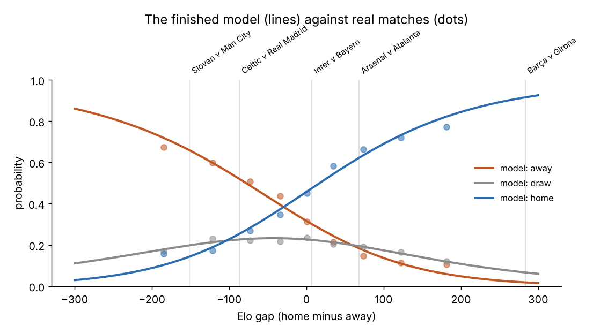

The lines are the model, the dots are the real groups of section 2. Worth noticing:

- **Inter v Bayern** is almost equal on paper, yet Inter get 47.5 % against 30.1 %: playing at home does that.
- **Even Barcelona v Girona** leaves Girona 1.8 %. The model never says 0 % or 100 %, because $e^x$ is never 0.
- **The draw is never the favourite**, in any match. That matches reality (draws are 20 to 23 % at almost any gap), but it means this model should never be used to "pick the result": it would never pick a draw.

---

## 9. Discovery: home advantage is worth about 29 points

On the picture, the home line and the away line cross at a gap of **−29.4**, not at 0. At that point the home side is 29 points weaker, and yet both sides have the same chance, 38.4 %.

So **playing at home is worth about 29 rating points.** Nobody told the model this: it has no "home" input at all. It found it because, in the data, home sides won more often than the ratings alone predicted, so the home judge learnt to start louder (+0.356 at gap 0, against −0.010 for the away judge).

**And on a neutral ground?** A final is played at a neutral stadium. The model plays the match twice in its head, once with each club at home, and takes the average:

| Arsenal v Atalanta | Arsenal win | Draw | Atalanta win |
|---|---:|---:|---:|
| Arsenal at home | 62.2 % | 19.4 % | 18.4 % |
| Atalanta at home | 47.5 % | 23.1 % | 29.4 % |
| **Neutral (average)** | **54.8 %** | **21.2 %** | **23.9 %** |

Arsenal drop from 62 % to 55 %: the missing 7 % was the home crowd.

---

## 10. Where do the numbers come from? Learning

The judges' slopes and starting values were given to you. The computer **learnt** them from the 5 251 matches. Here is how, without any advanced maths.

### 10.1 Measuring how wrong a forecast is: surprise

The model gave Arsenal 62.2 % and Arsenal won: not very surprising. A draw (19.4 %): more surprising. Girona winning at Barcelona (1.8 %): a huge shock. We measure the shock with:

$$\text{surprise} = -\ln(p)$$

where $p$ is the chance the model gave to **what actually happened**, and $\ln$ is the "natural logarithm", the undo button of $e^x$ (if $e^{a} = b$ then $\ln b = a$). Just watch the numbers:

| What happened | Model had said | Surprise |
|---|---:|---:|
| Barcelona beat Girona | 91.5 % | 0.09 (barely surprised) |
| Arsenal beat Atalanta | 62.2 % | 0.47 |
| Arsenal draw with Atalanta | 19.4 % | 1.64 |
| Girona win at Barcelona | 1.8 % | 4.02 (enormous shock) |
| a model that said 100 % and was right | 100 % | 0 |

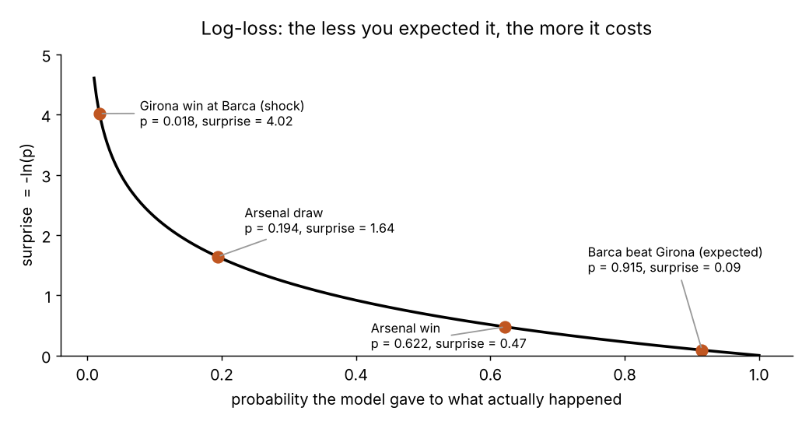

Being confidently wrong is punished **much** harder than being a bit unsure. The average surprise over many matches is called the **log-loss** (or **cross-entropy**). Lower is better.

### 10.2 Training: turning the knobs until surprise is smallest

The six numbers of the judges are like six knobs. Training means: **turn the knobs until the average surprise over all 5 251 matches is as small as possible.**

We can watch it. Take the trained model, multiply all slopes by a factor, and measure the average surprise each time:

| Slopes multiplied by | What the model becomes | Average surprise |
|---:|---|---:|
| 0 | ignores the gap, always says 45.7 / 22.6 / 31.7 | 1.051 |
| 0.5 | too timid | 0.979 |
| **1 (the trained model)** | **just right** | **0.958** |
| 2 | too confident | 1.017 |
| 4 | wildly overconfident | 1.321 |

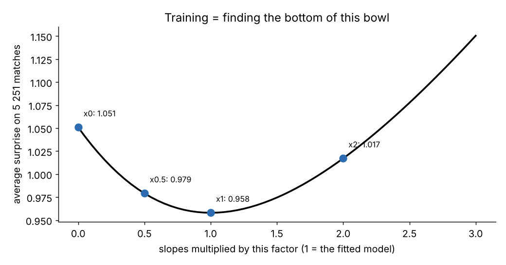

The curve is a **bowl**, and training is rolling a ball to the bottom. The computer checks which direction is downhill and steps that way, many times. For this model, the downhill direction has a very simple form: **predicted minus actual**. If the model said 62.2 % home win and the match was a home win (which counts as 100 %), the error is 0.622 − 1 = −0.378, so the home judge is pushed to be louder for gaps like this one.

With all slopes at 0, the model only knows how often each result happens in general. That "know-nothing" forecast scores 1.051. Everything the rating gap teaches us is the drop from 1.051 to 0.958.

### 10.3 A small brake: the penalty

Section 6.4 showed that adding the same number to all three scores changes nothing. So many settings of the knobs give exactly the same forecasts. Which one should the computer choose?

It adds a tiny extra cost that grows with the size of the slopes. The cost is so small it changes no forecast, but among equally good settings it picks the one with the smallest slopes. That is why the three slopes add up to exactly 0 (−0.538 − 0.031 + 0.569 = 0). This extra cost is called an **L2 penalty**, or **regularisation**.

### 10.4 Why the gap is standardised

The same training, run four times, changing only the unit of the gap:

| Unit of the gap | Steps needed | Home slope learnt | Average surprise |
|---|---:|---:|---:|
| **typical gaps (standardised)** | **6** | **0.569** | **0.9580** |
| rating points | 32 | 0.00644 | 0.9580 |
| thousandths of a point | 67 | 0.00000644 | 0.9580 |
| thousands of points | 17 | 5.85 | **0.9587** |

- **Speed.** With a huge or tiny unit, the bowl becomes a long thin valley, and the ball zig-zags: 6 steps become 32, then 67.
- **A fair brake.** In the last row, the right slope would be 6.43, but the penalty punishes big slopes and pushes it down to 5.85, so the model gets worse. The same data gives a different model just because of the unit. Standardising picks the unit from the data, so the brake always acts the same way.
- **Readable numbers.** "0.569 per typical gap" can be discussed; "0.00000644 per thousandth of a point" cannot.

For this one-input model, standardising does not improve the forecasts. It buys speed, a fair brake and a model ready for more inputs.

---

## 11. Two results against three, on six matches

Six made-up matches, small enough to check by hand. Their gaps have an average of exactly 0 and a typical gap of exactly 100, so $x' = \text{gap} / 100$.

| Match | Gap | $x'$ | Result | Two-result answer: "home win?" |
|---|---:|---:|---|:---:|
| A | +140 | 1.4 | home win | yes |
| B | +100 | 1.0 | home win | yes |
| C | +20 | 0.2 | draw | no |
| D | −20 | −0.2 | home win | yes |
| E | −100 | −1.0 | draw | no |
| F | −140 | −1.4 | away win | no |

The two-result version **throws information away**: for it, the draw of C and the away win of F are the same answer, "no".

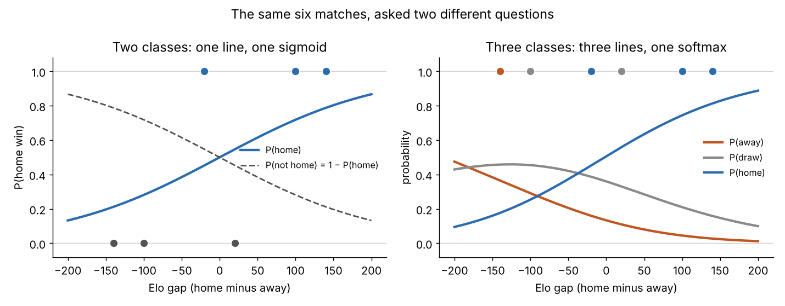

Match C (home side 20 points stronger, ends in a **draw**) through both trained models:

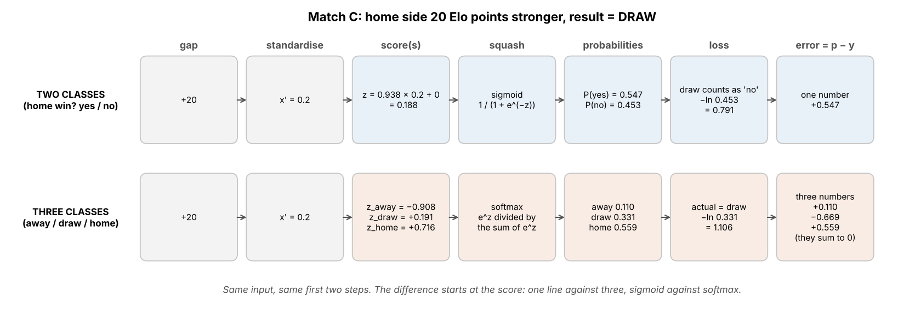

| Step | Two results | Three results |
|---|---|---|
| standardised gap | 0.2 | 0.2 |
| scores | one: 0.938 × 0.2 + 0 = 0.188 | away −0.908, draw +0.191, home +0.716 |
| chances | home win 54.7 %, not a home win 45.3 % | away 11.0 %, draw 33.1 %, home 55.9 % |
| surprise (the result was a draw) | −ln(0.453) = 0.791 | −ln(0.331) = 1.106 |
| error "predicted minus actual" | one number: +0.547 | three numbers: +0.110, −0.669, +0.559 (total 0) |

What to notice:

- Up to the standardised gap, both are identical. The difference starts at the scores.
- The two-result model only learns that C was "not a home win". The three-result model learns that it was a **draw**: its error on the draw judge (−0.669) means "the draw was too low", and the other two judges are pushed down.
- The surprises (0.791 and 1.106) **cannot be compared**: a blind guess scores 0.693 with two results and 1.099 with three. Compare each model with its own blind guess instead.

---

## 12. The whole algorithm, from start to finish

### 12.1 Training: once, with `python -m model.predictor --train`

| # | Step | Real numbers today |
|---|---|---|
| 1 | Read `match_features.csv`, keep the matches that have a result | 5 328 rows, 5 251 kept |
| 2 | Input: the rating gap before the match; answer: −1 (away win), 0 (draw) or +1 (home win) | one row per match |
| 3 | Hide some matches as an exam, to test the model later | 457 for training, 4 794 for the exam (this split is upside down, see section 16) |
| 4 | Measure the average gap and the typical gap | −0.1508 and 88.4953 |
| 5 | Train: roll down the bowl with the small brake | about 6 steps |
| 6 | Mark the exam, and the know-nothing forecast on the same matches | 0.967 against 1.051 |
| 7 | Train again on all matches | average surprise 0.958 |
| 8 | Check the order of the results is away, draw, home | (−1, 0, 1) |
| 9 | Save the 8 numbers (average gap, typical gap, 3 slopes, 3 starting values) | `data/reference/predictor_weights.json` |

After that, scikit-learn is not needed any more. The app only needs those 8 numbers and Python's `math` module.

### 12.2 Predicting: before every simulated match

| # | Step | Arsenal (1787.88) v Atalanta (1720.12) |
|---|---|---|
| 1 | Gap | 67.76 |
| 2 | Standardise | 0.767 |
| 3 | Three scores | home 0.793, draw −0.369, away −0.423 |
| 4 | Subtract the biggest score (section 6.4) | 0, −1.162, −1.216 |
| 5 | $e^x$ of each | 1, 0.313, 0.296 |
| 6 | Divide by the total, 1.609 | **62.2 %, 19.4 %, 18.4 %** |
| 7 | Neutral ground? Do it twice and average (section 9) | 54.8 %, 21.2 %, 23.9 % |

### 12.3 Rolling the die

The simulation draws a random number $u$ between 0 and 1 (every value equally likely) and cuts the line into three pieces:

```
0                    0.622          0.816        1
|------ home win ------|---- draw ----|-- away --|
```

$u = 0.41$ gives an Arsenal win, $u = 0.70$ a draw, $u = 0.93$ an Atalanta win. Each piece is exactly as long as its chance, so over many simulations Arsenal win 62.2 % of the time. Then a score is picked for that result ([`scorelines.md`](scorelines.md)) and both ratings are updated ([`elo.md`](elo.md)).

---

## 13. Is it any good?

| Forecaster | How it works | Average surprise |
|---|---|---:|
| the coin | always 33 / 33 / 33 | 1.099 |
| the know-nothing | always the usual frequencies, 46 / 21 / 34 | 1.050 |
| **this model** | uses the rating gap | **0.958** |

The gain looks small, but football is one of the most random sports: few goals, many draws, lots of luck. Beating the know-nothing forecast at all proves the ratings carry real information.

**Is "62 %" really 62 %?** Take all the matches where the model said "between 65 % and 80 % home win": it said 73 % on average, and the home side really won 66.7 %. When it gave the home side under 20 %, the home side won 16.7 % instead of 13.2 %. So the model is **a little too confident at both ends**: outsiders win a bit more often than it believes. Checking this is called **calibration**.

---

## 14. Try it yourself

The whole model in plain Python, with the real numbers from `predictor_weights.json`. No library to install.

```python
import math

AVERAGE_GAP, TYPICAL_GAP = -0.1508, 88.4953
SLOPE = {"away": -0.5384, "draw": -0.0308, "home": +0.5692}
START = {"away": -0.0103, "draw": -0.3459, "home": +0.3562}

def forecast(rating_home, rating_away):
    gap = rating_home - rating_away
    x = (gap - AVERAGE_GAP) / TYPICAL_GAP                         # step 0: standardise
    scores = {k: SLOPE[k] * x + START[k] for k in SLOPE}          # step 1: three judges
    powered = {k: math.exp(s) for k, s in scores.items()}         # step 2a: make positive
    total = sum(powered.values())
    return {k: round(v / total, 3) for k, v in powered.items()}   # step 2b: shares

print(forecast(1787.88, 1720.12))   # Arsenal v Atalanta
print(forecast(1700, 1700))         # two equal clubs
```

Output:

```
{'away': 0.184, 'draw': 0.194, 'home': 0.622}
{'away': 0.316, 'draw': 0.226, 'home': 0.457}
```

Two equal clubs, and the home side is still the favourite: that is the home advantage of section 9. Try setting every slope to 0: every match then gets the same forecast, whatever the ratings. Try adding 5 to every starting value: nothing changes (section 6.4).

---

## 15. What the code uses

### Python modules

| Module | Comes with Python? | What it does here |
|---|---|---|
| `scikit-learn` | no, install with `pip` | **training only**: `StandardScaler` measures the average and typical gap, `LogisticRegression` finds the six numbers, `Pipeline` chains the two, `log_loss` marks the exam |
| `pandas` | no | **training only**: reads `match_features.csv` |
| `numpy` | no | **training only**: arrays for scikit-learn, the know-nothing forecast |
| `math` | yes | **predicting**: `math.exp` for softmax |
| `json` | yes | saves and reads the 8 numbers |
| `datetime` | yes | writes the training date in the saved file |
| `pathlib` | yes | file paths |
| `sys` | yes | reads the `--train` option |

scikit-learn, pandas and numpy are imported **inside** the training function only, so the app can run without them.

### Who does what

| Job | Done by |
|---|---|
| Building the training data (ratings before each match, result) | this project, `model/elo_score_updating_copy.py` |
| Measuring the average and typical gap | scikit-learn, `StandardScaler` |
| Finding the six numbers (rolling down the bowl, with the brake) | scikit-learn, `LogisticRegression(max_iter=1000)` |
| The exam and the know-nothing comparison | this project, with scikit-learn's `log_loss` |
| Saving the 8 numbers to JSON | this project |
| Predicting every simulated match (sections 12.2 and 12.3) | this project, by hand, with `math` only |

The prediction is rewritten by hand instead of calling scikit-learn's `predict_proba`, for speed: a simulation makes about 90 000 predictions, and `predict_proba` costs about 0.5 ms each (45 seconds in total), against well under a second by hand. It gives exactly the same numbers.

### Functions and classes in `model/predictor.py`

| Name | In one line |
|---|---|
| `train` | trains the model and saves the 8 numbers (section 12.1) |
| `MatchModel` | holds the 8 numbers and computes the chances |
| `MatchModel.load` | reads `predictor_weights.json`, with a clear message if it is missing |
| `MatchModel.scores` | computes the gap, the standardised gap and the three scores |
| `MatchModel.probabilities` | does softmax, and the neutral-ground average when asked |
| `Probs` | a small record holding the three chances |
| `format_trace` | writes every step as text for the expert log |
| `PredictorError` | the error raised when the model cannot be used |

`model/match_engine.py` repeats the same few lines of maths inside its fast path, to save time in long simulations.

How to run it, from the project folder:

```bash
python -m model.predictor --train   # train and save the 8 numbers
python -m model.predictor           # print the forecasts for a few gaps
```

How each line works: [`code/predictor_code.md`](code/predictor_code.md).

### Files

| File | Role |
|---|---|
| `data/processed/match_features.csv` | input of training (written by the Elo program) |
| `data/reference/predictor_weights.json` | the 8 numbers, read by the app |

---

## 16. What can go wrong

- **It only knows the rating gap.** Injuries, tiredness, a new manager, the score of a first leg: the model has never heard of them.
- **It never predicts a draw as most likely** (section 8).
- **It is a little too confident** (section 13).
- **The predictor and Elo disagree.** For equal clubs, the predictor expects the home side to take 0.570 of the point, Elo 0.500. In the simulation, results come from the predictor but ratings move with Elo's expected score, so favourites slowly gain points over a competition.
- **It learnt from about 1.5 seasons only**, including 625 friendlies that probably should not be there.

### Known bugs

- **The exam is upside down.** The code keeps the last season with enough matches as the exam. With today's file that is 2024, so it trains on 2023 only: **457 training matches, 4 794 exam matches**. The reported 0.967 is too pessimistic. Splitting by date instead (the first 80 % to train, the last 20 % as the exam) gives 0.951 against 1.048 for the know-nothing forecast. Fix:

  ```python
  cut = int(len(df) * 0.8)                 # the rows are already in date order
  train_mask = np.arange(len(df)) < cut
  ```

- **The order of the results is read but not checked.** The saved file lists the order (away, draw, home), but the prediction code ignores it and assumes that order. A file with another order would silently swap home and away.
- **The 8 numbers are out of date** after any fix to the Elo program. After such a fix: recompute the ratings with `--write`, then train again with `--train`.

---

## 17. Ideas for later

1. **A fixed exam** (the fix above), so every later change is marked on the same matches.
2. **Remove friendlies** from the training data, and compare on the same exam.
3. **An "ordered" model.** Away, draw and home are in order; an ordered logistic regression uses one slope and two cut points instead of three slopes.
4. **More inputs**, each kept only if it improves the exam: a real home flag, the competition, days of rest.
5. **The training written by hand.** Re-write the training with NumPy (softmax, surprise, "predicted minus actual", steps downhill, the brake) and check that it finds the same six numbers as scikit-learn. The six matches of section 11 make a good first test.

---

## 18. The whole story on one page

1. **Problem:** turn a rating gap into three chances that add up to 100 %.
2. **Step 0:** measure the gap in typical gaps of 88.5 points.
3. **Step 1:** three judges, three straight lines, three scores.
4. **Step 2:** softmax: $e^x$ of each score, then divide by the total.
5. **Name:** with two results, softmax is the S-shaped logistic curve, hence **logistic regression**; with three results learnt together, it is **multinomial**.
6. **Learning:** turn six knobs until the average surprise is smallest, with a small brake.
7. **Result:** average surprise 0.958 against 1.050 for the know-nothing forecast; home advantage worth about 29 points; a little too confident; never picks a draw.

"Regression" is in the name for historical reasons: the model is really used to sort matches into three classes.

---

## 19. Words to know

| Word | Meaning |
|---|---|
| standardised gap | the rating gap measured in "typical gaps" of 88.5 points |
| score (logit) | the number each judge calls out; any value allowed |
| intercept (starting value) | a judge's score when the gap is 0 |
| softmax | "$e^x$ of each score, then divide by the total": turns scores into chances that add up to 100 % |
| sigmoid, logistic curve | the S-shaped curve of the two-result case |
| multinomial | with several categories, here three |
| surprise, log-loss | $-\ln$ of the chance given to what happened; its average over many matches |
| training | turning the model's numbers until the average surprise is smallest |
| L2 penalty, regularisation | a small extra cost that keeps the numbers small |
| calibration | checking that "60 %" forecasts come true about 60 % of the time |
| exam (holdout) | matches hidden during training, used to test the model fairly |
| scikit-learn | the Python machine learning library used to train this model |

---
---


# Le modèle de match : d'un écart de notes à trois chances

> Donne à ce modèle les notes de deux clubs, et il te rend trois chances : l'équipe à domicile gagne, c'est un nul, l'équipe à l'extérieur gagne. Il a appris à le faire à partir de 5 251 vrais matchs européens. Son vrai nom est **régression logistique multinomiale** ; à la section 7, tu sauras ce que veut dire chacun de ces mots.

## En bref

- **Ce qui entre :** deux notes Elo, par exemple Arsenal 1787.88 à domicile contre l'Atalanta 1720.12 (les notes sont expliquées dans [`elo.md`](elo.md)).
- **Ce qui sort :** trois chances qui font 100 % au total, par exemple 62.2 % victoire à domicile, 19.4 % nul, 18.4 % victoire à l'extérieur.
- **Où c'est utilisé :** avant chaque match simulé, pour décider à quel point chaque résultat est probable.
- **Code :** `model/predictor.py`. Explication ligne par ligne : [`code/predictor_code.md`](code/predictor_code.md).

**Comment lire cette page.** Les sections 1 à 14 racontent l'histoire avec des nombres que tu peux vérifier à la calculatrice ; rien de plus n'est nécessaire. Les sections 15 à 17 sont pour ceux qui travaillent sur le code.

**Avant de commencer**, il te faut seulement trois choses :

| Il te faut | Petit test | Sinon |
|---|---|---|
| savoir ce qu'est une note Elo | Un club noté 1800 joue un club noté 1700. Lequel est le plus fort, et de combien ? | [`elo.md`](elo.md), sections 2 et 3 |
| les pourcentages | Une météo annonce « 70 % de chances de pluie ». Sur 10 jours comme celui-ci, combien devraient être pluvieux ? | [Maths is Fun : probabilité (en anglais)](https://www.mathsisfun.com/data/probability.html) |
| la touche $e^x$ d'une calculatrice | Tape $e^1$ : environ 2.718 ? Tape $e^{-1}$ : environ 0.368 ? | [Maths is Fun : le nombre e (en anglais)](https://www.mathsisfun.com/numbers/e-eulers-number.html) |

---

## 1. La question

Arsenal reçoivent l'Atalanta. Arsenal ont une note de 1787.88, l'Atalanta 1720.12. Qui gagne ?

Personne ne le sait. Le football est plein de hasard : un tir dévié, un carton rouge, un gardien dans le match de sa vie. Ce qu'on *peut* donner ressemble à une météo :

> « Arsenal gagnent environ 62 fois sur 100, font nul environ 19 fois, perdent environ 18 fois. »

C'est ce que produit ce modèle : **trois chances**, une par résultat, qui font toujours 100 % au total.

Pourquoi ne pas simplement choisir un gagnant ? Parce que la simulation ne veut pas une réponse : elle veut **lancer un dé**. Elle joue chaque match de la compétition, puis rejoue toute la compétition des centaines de fois. Si Arsenal gagnaient toujours, l'Atalanta n'aurait jamais de soir de chance, et le vrai football en est plein.

Toute la page répond donc à une question :

> **Comment transformer « Arsenal ont 67.76 points de plus » en « 62 % / 19 % / 18 % » ?**

---

## 2. Ce que disent les vrais matchs

Avant de construire quoi que ce soit, regardons les données : 5 251 vrais matchs, rangés en groupes selon l'écart de notes. L'**écart** est la note du club à domicile moins celle du club à l'extérieur ; un écart positif veut donc dire que l'équipe à domicile est plus forte.

| Écart de notes | Matchs | Victoires à domicile | Nuls | Victoires à l'extérieur |
|---|---:|---:|---:|---:|
| −300 à −150 (domicile bien plus faible) | 260 | 15.8 % | 16.9 % | 67.3 % |
| −150 à −100 | 437 | 17.2 % | 23.1 % | 59.7 % |
| −100 à −50 | 785 | 26.9 % | 22.3 % | 50.8 % |
| −50 à −20 | 590 | 34.6 % | 21.7 % | 43.7 % |
| −20 à +20 (à peu près égaux) | 1 114 | 45.1 % | 23.5 % | 31.4 % |
| +20 à +50 | 614 | 58.3 % | 20.4 % | 21.3 % |
| +50 à +100 | 748 | 66.4 % | 19.0 % | 14.6 % |
| +100 à +150 | 448 | 72.1 % | 16.5 % | 11.4 % |
| +150 à +300 (domicile bien plus fort) | 255 | 77.3 % | 12.2 % | 10.6 % |


Trois choses sautent aux yeux, et tout le modèle repose sur elles :

1. **Plus l'équipe à domicile est forte, plus elle gagne** : de 16 % à 77 %.
2. **Les nuls se moquent presque de l'écart.** Ils restent autour de 20 %, un peu moins quand un camp est bien plus fort.
3. **Regarde la ligne du milieu.** Quand les clubs sont égaux, l'équipe à domicile gagne 45 % et celle à l'extérieur seulement 31 %. C'est l'**avantage du terrain**. Il revient à la section 9.

Pourquoi ne pas utiliser ce tableau tel quel ? Pour Arsenal-Atalanta (écart +67.76), on lirait la ligne « +50 à +100 » : 66 / 19 / 15. Pas mal, mais :

- un écart de +51 et un écart de +99 reçoivent **la même réponse**, alors que +99 est nettement plus fort ;
- un écart de +350 n'a **aucune ligne** ;
- chaque ligne est un peu bruitée : la ligne « −150 à −100 » a *plus* de nuls que ses voisines, sans doute par hasard.

On veut une **courbe lisse** qui suit le tableau, marche pour n'importe quel écart et ignore le bruit. Construire cette courbe, c'est ce qu'on appelle « ajuster un modèle ».

---

## 3. La première idée, et pourquoi elle échoue

La ligne lisse la plus simple est une droite. La meilleure droite à travers la colonne des victoires à domicile est :

$$\text{chance de victoire à domicile} = 0.459 + 0.00214 \times \text{écart}$$

Lis-la comme une recette : partir de 45.9 %, puis ajouter 0.214 % par point d'écart.

| Écart | Ce que dit la droite |
|---|---|
| +100 | 67.3 % (correct) |
| +300 | 110 % (impossible) |
| −400 | −40 % (une chance négative ?) |


Une chance doit rester entre 0 % et 100 %. Une droite ne s'arrête jamais de monter, donc tôt ou tard elle sort de cet intervalle. Il faut quelque chose qui **se courbe** : raide au milieu, plat près de 0 % et de 100 %. Les étapes suivantes construisent exactement cela.

---

## 4. Étape 0 : mesurer l'écart en « écarts typiques »

D'abord, le modèle change l'**unité** de l'écart. Au lieu de « 67.76 points », il demande « combien d'**écarts typiques** cela fait-il ? ».

Dans les données, un écart typique vaut 88.50 points (environ deux matchs sur trois ont un écart entre −88.5 et +88.5), et l'écart moyen vaut presque exactement 0 (−0.15). Donc :

$$x' = \frac{\text{écart} - \text{écart moyen}}{\text{écart typique}} = \frac{\text{écart} + 0.15}{88.50}$$

$x'$ (« x prime ») est l'écart mesuré en écarts typiques. On l'appelle l'**écart standardisé**.

| Écart en points | Écart standardisé $x'$ | En mots |
|---:|---:|---|
| 0 | 0.002 | deux clubs égaux |
| +67.76 (Arsenal-Atalanta) | 0.767 | trois quarts d'un écart typique |
| +100 | 1.132 | un peu plus d'un écart typique |
| +283.34 (Barcelone-Girona) | 3.203 | trois écarts typiques : un énorme déséquilibre |


C'est comme dire « il fait deux têtes de plus » au lieu de « il fait 46 cm de plus » : même fait, autre règle graduée. Rien n'est perdu.

Deux règles vont avec :

- L'écart moyen et l'écart typique sont **mesurés une seule fois, sur les matchs d'entraînement**, puis enregistrés et réutilisés pour chaque prédiction. S'ils étaient remesurés sur de nouveaux matchs, la règle changerait entre l'apprentissage et l'utilisation.
- Changer de règle ne change jamais ce que le modèle *peut* dire, seulement la vitesse et la justesse de son apprentissage (la section 10.4 explique pourquoi).

> **Avec une seule entrée, à quoi bon ?** Le modèle n'a qu'une entrée, l'écart de notes, donc cette étape ne change presque rien. Elle vient d'une ancienne version à deux entrées (l'écart, et un indicateur « domicile » valant 0 ou 1) ; avec plusieurs entrées, les mettre toutes sur la même règle compte beaucoup. Elle sera peut-être retirée du code un jour, mais elle reste dans cette page car toute future version avec plus d'entrées en aura besoin.

---

## 5. Étape 1 : donner un score à chaque résultat

Voici l'astuce, en deux étapes. La première oublie complètement les chances.

Imagine trois juges. Un défend « victoire à domicile », un « nul », un « victoire à l'extérieur ». Chaque juge regarde l'écart standardisé et annonce un **score** : n'importe quel nombre, grand, petit ou négatif. Un score plus grand veut dire « je crois davantage à mon résultat ».

Chaque juge utilise sa propre droite (une droite convient ici, car un score a le droit de valoir n'importe quoi) :

$$\text{score} = \text{pente} \times x' + \text{valeur de départ}$$

| Juge | Pente | Valeur de départ (score à écart 0) | Score à écart +100 | Ce que ça veut dire |
|---|---:|---:|---:|---|
| domicile | +0.569 | +0.356 | +1.000 | une équipe à domicile plus forte rend ce juge plus bruyant |
| nul | −0.031 | −0.346 | −0.381 | l'écart fait à peine bouger ce juge |
| extérieur | −0.538 | −0.010 | −0.620 | une équipe à domicile plus forte rend ce juge plus discret |

Les pentes et les valeurs de départ sont apprises à partir des données (section 10). La valeur de départ s'appelle souvent l'**ordonnée à l'origine**.


Pour Arsenal-Atalanta ($x' = 0.767$) :

| | domicile | nul | extérieur |
|---|---:|---:|---:|
| score | **+0.793** | **−0.369** | **−0.423** |

Le juge « domicile » est le plus bruyant. Logique : Arsenal sont plus forts et à domicile. Mais « +0.793 » n'est pas encore une chance.

> En apprentissage automatique, ces scores s'appellent des **logits**. Même chose, nom plus long.

---

## 6. Étape 2 : transformer les scores en chances (softmax)

### 6.1 L'idée évidente ne marche pas

« Diviser chaque score par le total. » Essaie sur trois scores inventés, 2, −1 et 0.5. Le total vaut 1.5, donc les parts valent 133 %, −67 % et 33 %. Cassé : un score négatif donne une chance négative. Chaque score doit d'abord devenir **positif**, sans changer lequel est le plus grand.

### 6.2 La solution : passer d'abord par $e^x$

La fonction $e^x$ (une touche de ta calculatrice) a deux propriétés utiles :

- elle est **toujours positive** : $e^{2} = 7.389$, $e^{0} = 1$, $e^{-1} = 0.368$, $e^{-10} = 0.0000454$ ;
- elle **garde l'ordre** : un score plus grand donne toujours un résultat plus grand.

Donc : d'abord $e^x$ de chaque score, *puis* diviser par le total.

| | score | $e^{\text{score}}$ | part du total |
|---|---:|---:|---:|
| A | 2 | 7.389 | 7.389 / 9.406 = 78.6 % |
| B | −1 | 0.368 | 0.368 / 9.406 = 3.9 % |
| C | 0.5 | 1.649 | 1.649 / 9.406 = 17.5 % |
| **total** | | **9.406** | **100 %** |

Tout est positif, le total fait 100 %, et le plus grand score gagne toujours. Cette recette en deux gestes (« $e^x$, puis diviser par le total ») s'appelle **softmax** :

$$\text{chance d'un résultat} = \frac{e^{\text{son score}}}{e^{\text{score domicile}} + e^{\text{score nul}} + e^{\text{score extérieur}}}$$

### 6.3 Softmax sur Arsenal-Atalanta


| | domicile | nul | extérieur | total |
|---|---:|---:|---:|---:|
| score | 0.793 | −0.369 | −0.423 | |
| $e^{\text{score}}$ | 2.210 | 0.691 | 0.655 | 3.556 |
| divisé par 3.556 | **62.2 %** | **19.4 %** | **18.4 %** | 100 % |

C'est la prévision de la section 1. Tout le modèle tient en ces deux étapes : trois droites, puis softmax.

### 6.4 Un fait étrange mais utile

Ajoute 10 à chaque score (12, 9 et 10.5 au lieu de 2, −1 et 0.5), et softmax donne exactement les mêmes 78.6 %, 3.9 %, 17.5 %.

Pourquoi ? Ajouter 10 à un score multiplie son $e^x$ par le même nombre ($e^{10}$), en haut et en bas de chaque fraction, donc cela s'annule. **Seules les différences entre scores comptent.** Le code s'en sert pour éviter un plantage : il soustrait le plus grand score aux trois avant d'utiliser $e^x$, car $e^{710}$ est trop grand pour qu'un ordinateur le stocke.

---

## 7. Alors, comment s'appelle ce modèle ?

### 7.1 « Régression logistique » : la version à deux résultats

Imagine un sport sans nul, comme le tennis. Softmax n'a alors que deux scores à partager, et elle se simplifie en :

$$\text{chance de victoire} = \frac{1}{1 + e^{-d}} \qquad d = \text{score « victoire »} - \text{score « défaite »}$$

| $d$ | −2 | −1 | 0 | +1 | +2 |
|---|---:|---:|---:|---:|---:|
| chance de victoire | 11.9 % | 26.9 % | 50.0 % | 73.1 % | 88.1 % |


Cette courbe en S, plate aux deux bouts et raide au milieu, est la **courbe logistique** (aussi appelée **sigmoïde**). Un modèle qui trace une droite puis la fait passer par cette courbe est une **régression logistique**. Le score attendu d'Elo est cette même courbe ([`elo.md`](elo.md), section 3).

### 7.2 « Multinomiale » : parce que le football a trois résultats

Le football a un troisième résultat, le nul. **Multinomial** veut dire « avec plusieurs catégories ». Une **régression logistique multinomiale** donne un score à chaque catégorie et les partage avec softmax, exactement comme aux sections 5 et 6. On l'appelle aussi **régression softmax**.

**Le nom précis de ce modèle est donc : une régression logistique multinomiale à trois classes (victoire à l'extérieur, nul, victoire à domicile) et une entrée (l'écart standardisé).**

### 7.3 L'autre façon, pas utilisée ici

Une façon plus paresseuse de gérer trois résultats est d'entraîner trois modèles oui/non séparés : « victoire à domicile, oui ou non ? », « nul, oui ou non ? », « victoire à l'extérieur, oui ou non ? ». On appelle cela **un contre tous** (*one-vs-rest*). Chaque modèle est entraîné seul, et rien ne force leurs réponses à s'accorder :

| Écart | « domicile ? » | « nul ? » | « extérieur ? » | **Total** |
|---:|---:|---:|---:|---:|
| +67.76 | 61.9 % | 19.2 % | 18.6 % | **99.8 %** |
| +200 | 86.0 % | 16.8 % | 5.8 % | **108.6 %** |
| −200 | 9.9 % | 24.9 % | 76.9 % | **111.6 %** |


Les totaux s'éloignent de 100 %. La version multinomiale apprend les trois scores **ensemble**, avec une seule softmax, donc le total vaut toujours exactement 100 %.

### 7.4 Deux résultats contre trois : ce qui change

| | Deux résultats (oui/non) | Trois résultats (ce projet) |
|---|---|---|
| Entrée | l'écart standardisé $x'$ | le même : **rien ne change** |
| Nombres appris | 1 pente, 1 valeur de départ | 3 pentes, 3 valeurs de départ |
| Scores | un | trois |
| Des scores aux chances | la courbe en S (sigmoïde) | softmax |
| Sortie | 1 chance (l'autre vaut 100 % moins elle) | 3 chances qui font 100 % au total |
| Surprise d'une réponse au hasard (section 10) | 0.693 | 1.099 |

En une phrase : passer de deux résultats à trois change le nombre de juges (un à trois) et la façon dont les scores deviennent des chances (courbe en S à softmax) ; l'entrée et la règle graduée restent les mêmes.

---

## 8. Toute la machine, sur cinq vrais matchs

```
notes  ->  écart  ->  écart standardisé  ->  trois scores  ->  softmax  ->  trois chances
1787.88 v 1720.12   67.76      0.767         0.793 / -0.369 / -0.423      62.2 % / 19.4 % / 18.4 %
```

| Match (domicile d'abord) | Notes | Écart | Victoire domicile | Nul | Victoire extérieur |
|---|---|---:|---:|---:|---:|
| Barcelone-Girona | 1841.33 v 1557.99 | +283.34 | **91.5 %** | 6.6 % | 1.8 % |
| Arsenal-Atalanta | 1787.88 v 1720.12 | +67.76 | **62.2 %** | 19.4 % | 18.4 % |
| Inter-Bayern Munich | 1818.07 v 1811.07 | +7.00 | **47.5 %** | 22.4 % | 30.1 % |
| Celtic-Real Madrid | 1700.88 v 1787.62 | −86.74 | 25.4 % | 22.6 % | **52.0 %** |
| Slovan Bratislava-Manchester City | 1600.39 v 1751.53 | −151.14 | 14.4 % | 19.8 % | **65.8 %** |


Les courbes sont le modèle, les points sont les vrais groupes de la section 2. À remarquer :

- **Inter-Bayern** est presque à égalité sur le papier, et pourtant l'Inter a 47.5 % contre 30.1 % : c'est l'effet du terrain.
- **Même Barcelone-Girona** laisse 1.8 % à Girona. Le modèle ne dit jamais 0 % ni 100 %, car $e^x$ ne vaut jamais 0.
- **Le nul n'est jamais le favori**, dans aucun match. C'est conforme à la réalité (les nuls font 20 à 23 % à presque n'importe quel écart), mais ce modèle ne doit donc jamais servir à « deviner le résultat » : il ne choisirait jamais un nul.

---

## 9. Découverte : l'avantage du terrain vaut environ 29 points

Sur le dessin, la courbe « domicile » et la courbe « extérieur » se croisent à un écart de **−29.4**, pas à 0. À ce point, l'équipe à domicile a 29 points de moins, et pourtant les deux camps ont la même chance, 38.4 %.

Donc **jouer à domicile vaut environ 29 points de note.** Personne ne l'a dit au modèle : il n'a aucune entrée « domicile ». Il l'a trouvé parce que, dans les données, les équipes à domicile gagnaient plus souvent que les notes seules ne le prévoyaient, donc le juge « domicile » a appris à partir plus fort (+0.356 à écart 0, contre −0.010 pour le juge « extérieur »).

**Et sur terrain neutre ?** Une finale se joue dans un stade neutre. Le modèle joue le match deux fois dans sa tête, une fois avec chaque club à domicile, et fait la moyenne :

| Arsenal-Atalanta | Arsenal gagnent | Nul | Atalanta gagne |
|---|---:|---:|---:|
| Arsenal à domicile | 62.2 % | 19.4 % | 18.4 % |
| Atalanta à domicile | 47.5 % | 23.1 % | 29.4 % |
| **Neutre (moyenne)** | **54.8 %** | **21.2 %** | **23.9 %** |

Arsenal passent de 62 % à 55 % : les 7 % manquants, c'était le public.

---

## 10. D'où viennent les nombres ? L'apprentissage

Les pentes et les valeurs de départ des juges t'ont été données. L'ordinateur les a **apprises** à partir des 5 251 matchs. Voici comment, sans maths avancées.

### 10.1 Mesurer à quel point une prévision se trompe : la surprise

Le modèle donnait 62.2 % à Arsenal et Arsenal ont gagné : pas très surprenant. Un nul (19.4 %) : plus surprenant. Girona qui gagne à Barcelone (1.8 %) : un énorme choc. On mesure le choc avec :

$$\text{surprise} = -\ln(p)$$

où $p$ est la chance que le modèle donnait à **ce qui s'est vraiment passé**, et $\ln$ est le « logarithme népérien », la touche qui annule $e^x$ (si $e^{a} = b$ alors $\ln b = a$). Regarde juste les nombres :

| Ce qui s'est passé | Le modèle avait dit | Surprise |
|---|---:|---:|
| Barcelone bat Girona | 91.5 % | 0.09 (à peine surpris) |
| Arsenal battent l'Atalanta | 62.2 % | 0.47 |
| Arsenal font nul contre l'Atalanta | 19.4 % | 1.64 |
| Girona gagne à Barcelone | 1.8 % | 4.02 (énorme choc) |
| un modèle qui disait 100 % et avait raison | 100 % | 0 |


Se tromper avec assurance est puni **beaucoup** plus fort qu'être un peu hésitant. La surprise moyenne sur beaucoup de matchs s'appelle la **log-loss** (ou **entropie croisée**). Plus elle est basse, mieux c'est.

### 10.2 L'entraînement : tourner les boutons jusqu'à la plus petite surprise

Les six nombres des juges sont comme six boutons. S'entraîner veut dire : **tourner les boutons jusqu'à ce que la surprise moyenne sur les 5 251 matchs soit la plus petite possible.**

On peut le voir. Prends le modèle entraîné, multiplie toutes les pentes par un facteur, et mesure la surprise moyenne à chaque fois :

| Pentes multipliées par | Ce que devient le modèle | Surprise moyenne |
|---:|---|---:|
| 0 | ignore l'écart, dit toujours 45.7 / 22.6 / 31.7 | 1.051 |
| 0.5 | trop timide | 0.979 |
| **1 (le modèle entraîné)** | **juste bien** | **0.958** |
| 2 | trop sûr de lui | 1.017 |
| 4 | beaucoup trop sûr de lui | 1.321 |


La courbe est un **bol**, et s'entraîner, c'est faire rouler une bille jusqu'au fond. L'ordinateur regarde de quel côté ça descend et fait un pas dans ce sens, de nombreuses fois. Pour ce modèle, le sens de la descente a une forme très simple : **prédit moins réel**. Si le modèle disait 62.2 % de victoire à domicile et que le match a été une victoire à domicile (ce qui compte comme 100 %), l'erreur vaut 0.622 − 1 = −0.378, donc le juge « domicile » est poussé à parler plus fort pour des écarts comme celui-ci.

Avec toutes les pentes à 0, le modèle sait seulement à quelle fréquence chaque résultat arrive en général. Cette prévision « qui ne sait rien » obtient 1.051. Tout ce que l'écart de notes nous apprend, c'est la baisse de 1.051 à 0.958.

### 10.3 Un petit frein : la pénalité

La section 6.4 a montré qu'ajouter le même nombre aux trois scores ne change rien. Beaucoup de réglages des boutons donnent donc exactement les mêmes prévisions. Lequel l'ordinateur doit-il choisir ?

Il ajoute un tout petit coût qui grandit avec la taille des pentes. Ce coût est si petit qu'il ne change aucune prévision, mais parmi des réglages aussi bons les uns que les autres, il choisit celui aux plus petites pentes. C'est pourquoi les trois pentes font exactement 0 au total (−0.538 − 0.031 + 0.569 = 0). Ce coût s'appelle une **pénalité L2**, ou **régularisation**.

### 10.4 Pourquoi l'écart est standardisé

Le même entraînement, lancé quatre fois, en changeant seulement l'unité de l'écart :

| Unité de l'écart | Pas nécessaires | Pente « domicile » apprise | Surprise moyenne |
|---|---:|---:|---:|
| **écarts typiques (standardisé)** | **6** | **0.569** | **0.9580** |
| points de note | 32 | 0.00644 | 0.9580 |
| millièmes de point | 67 | 0.00000644 | 0.9580 |
| milliers de points | 17 | 5.85 | **0.9587** |

- **Vitesse.** Avec une unité énorme ou minuscule, le bol devient une longue vallée étroite, et la bille zigzague : 6 pas deviennent 32, puis 67.
- **Un frein juste.** À la dernière ligne, la bonne pente serait 6.43, mais la pénalité punit les grandes pentes et la ramène à 5.85, donc le modèle devient moins bon. Les mêmes données donnent un autre modèle juste à cause de l'unité. Standardiser choisit l'unité à partir des données, donc le frein agit toujours de la même façon.
- **Des nombres lisibles.** « 0.569 par écart typique » se discute ; « 0.00000644 par millième de point », non.

Pour ce modèle à une entrée, standardiser n'améliore pas les prévisions. Cela apporte de la vitesse, un frein juste et un modèle prêt pour plus d'entrées.

---

## 11. Deux résultats contre trois, sur six matchs

Six matchs inventés, assez petits pour tout vérifier à la main. Leurs écarts ont une moyenne d'exactement 0 et un écart typique d'exactement 100, donc $x' = \text{écart} / 100$.

| Match | Écart | $x'$ | Résultat | Réponse à deux résultats : « victoire à domicile ? » |
|---|---:|---:|---|:---:|
| A | +140 | 1.4 | victoire domicile | oui |
| B | +100 | 1.0 | victoire domicile | oui |
| C | +20 | 0.2 | nul | non |
| D | −20 | −0.2 | victoire domicile | oui |
| E | −100 | −1.0 | nul | non |
| F | −140 | −1.4 | victoire extérieur | non |

La version à deux résultats **jette de l'information** : pour elle, le nul de C et la victoire à l'extérieur de F sont la même réponse, « non ».


Le match C (domicile plus fort de 20 points, finit sur un **nul**) à travers les deux modèles entraînés :


| Étape | Deux résultats | Trois résultats |
|---|---|---|
| écart standardisé | 0.2 | 0.2 |
| scores | un : 0.938 × 0.2 + 0 = 0.188 | extérieur −0.908, nul +0.191, domicile +0.716 |
| chances | victoire domicile 54.7 %, pas une victoire domicile 45.3 % | extérieur 11.0 %, nul 33.1 %, domicile 55.9 % |
| surprise (le résultat était un nul) | −ln(0.453) = 0.791 | −ln(0.331) = 1.106 |
| erreur « prédit moins réel » | un nombre : +0.547 | trois nombres : +0.110, −0.669, +0.559 (total 0) |

À remarquer :

- Jusqu'à l'écart standardisé, les deux sont identiques. La différence commence aux scores.
- Le modèle à deux résultats apprend seulement que C n'était « pas une victoire à domicile ». Le modèle à trois résultats apprend que c'était un **nul** : son erreur sur le juge « nul » (−0.669) veut dire « le nul était trop bas », et les deux autres juges sont poussés vers le bas.
- Les surprises (0.791 et 1.106) **ne se comparent pas** : une réponse au hasard obtient 0.693 avec deux résultats et 1.099 avec trois. Compare plutôt chaque modèle à sa propre réponse au hasard.

---

## 12. Tout l'algorithme, du début à la fin

### 12.1 L'entraînement : une seule fois, avec `python -m model.predictor --train`

| # | Étape | Vrais nombres aujourd'hui |
|---|---|---|
| 1 | Lire `match_features.csv`, garder les matchs qui ont un résultat | 5 328 lignes, 5 251 gardées |
| 2 | Entrée : l'écart de notes avant le match ; réponse : −1 (victoire extérieur), 0 (nul) ou +1 (victoire domicile) | une ligne par match |
| 3 | Cacher des matchs comme examen, pour tester le modèle ensuite | 457 pour l'entraînement, 4 794 pour l'examen (ce découpage est à l'envers, voir section 16) |
| 4 | Mesurer l'écart moyen et l'écart typique | −0.1508 et 88.4953 |
| 5 | S'entraîner : faire rouler la bille au fond du bol, avec le petit frein | environ 6 pas |
| 6 | Noter l'examen, et la prévision « qui ne sait rien » sur les mêmes matchs | 0.967 contre 1.051 |
| 7 | S'entraîner à nouveau sur tous les matchs | surprise moyenne 0.958 |
| 8 | Vérifier que l'ordre des résultats est extérieur, nul, domicile | (−1, 0, 1) |
| 9 | Enregistrer les 8 nombres (écart moyen, écart typique, 3 pentes, 3 valeurs de départ) | `data/reference/predictor_weights.json` |

Ensuite, scikit-learn n'est plus nécessaire. L'appli n'a besoin que de ces 8 nombres et du module `math` de Python.

### 12.2 Prédire : avant chaque match simulé

| # | Étape | Arsenal (1787.88) contre Atalanta (1720.12) |
|---|---|---|
| 1 | Écart | 67.76 |
| 2 | Standardiser | 0.767 |
| 3 | Trois scores | domicile 0.793, nul −0.369, extérieur −0.423 |
| 4 | Soustraire le plus grand score (section 6.4) | 0, −1.162, −1.216 |
| 5 | $e^x$ de chacun | 1, 0.313, 0.296 |
| 6 | Diviser par le total, 1.609 | **62.2 %, 19.4 %, 18.4 %** |
| 7 | Terrain neutre ? Le faire deux fois et faire la moyenne (section 9) | 54.8 %, 21.2 %, 23.9 % |

### 12.3 Lancer le dé

La simulation tire un nombre au hasard $u$ entre 0 et 1 (toutes les valeurs ont la même chance) et coupe la ligne en trois morceaux :

```
0                    0.622          0.816        1
|---- victoire dom. ---|---- nul -----|-- ext. --|
```

$u = 0.41$ donne une victoire d'Arsenal, $u = 0.70$ un nul, $u = 0.93$ une victoire de l'Atalanta. Chaque morceau est exactement aussi long que sa chance, donc sur beaucoup de simulations Arsenal gagnent 62.2 % du temps. Ensuite un score est choisi pour ce résultat ([`scorelines.md`](scorelines.md)) et les deux notes sont mises à jour ([`elo.md`](elo.md)).

---

## 13. Est-il bon ?

| Prévisionniste | Comment il marche | Surprise moyenne |
|---|---|---:|
| la pièce | toujours 33 / 33 / 33 | 1.099 |
| celui qui ne sait rien | toujours les fréquences habituelles, 46 / 21 / 34 | 1.050 |
| **ce modèle** | utilise l'écart de notes | **0.958** |

Le gain paraît petit, mais le football est l'un des sports les plus aléatoires : peu de buts, beaucoup de nuls, beaucoup de chance. Battre celui qui ne sait rien prouve déjà que les notes contiennent une vraie information.

**« 62 % », est-ce vraiment 62 % ?** Prends tous les matchs où le modèle annonçait « entre 65 % et 80 % de victoire à domicile » : il annonçait 73 % en moyenne, et l'équipe à domicile a vraiment gagné 66.7 %. Quand il donnait moins de 20 % à l'équipe à domicile, elle a gagné 16.7 % au lieu de 13.2 %. Le modèle est donc **un peu trop sûr de lui aux deux bouts** : les outsiders gagnent un peu plus souvent qu'il ne le croit. Vérifier cela s'appelle le **calibrage**.

---

## 14. À essayer toi-même

Tout le modèle en Python simple, avec les vrais nombres de `predictor_weights.json`. Aucune bibliothèque à installer.

```python
import math

AVERAGE_GAP, TYPICAL_GAP = -0.1508, 88.4953
SLOPE = {"away": -0.5384, "draw": -0.0308, "home": +0.5692}
START = {"away": -0.0103, "draw": -0.3459, "home": +0.3562}

def forecast(rating_home, rating_away):
    gap = rating_home - rating_away
    x = (gap - AVERAGE_GAP) / TYPICAL_GAP                         # étape 0 : standardiser
    scores = {k: SLOPE[k] * x + START[k] for k in SLOPE}          # étape 1 : trois juges
    powered = {k: math.exp(s) for k, s in scores.items()}         # étape 2a : rendre positif
    total = sum(powered.values())
    return {k: round(v / total, 3) for k, v in powered.items()}   # étape 2b : les parts

print(forecast(1787.88, 1720.12))   # Arsenal-Atalanta
print(forecast(1700, 1700))         # deux clubs égaux
```

Résultat :

```
{'away': 0.184, 'draw': 0.194, 'home': 0.622}
{'away': 0.316, 'draw': 0.226, 'home': 0.457}
```

Deux clubs égaux, et l'équipe à domicile reste favorite : c'est l'avantage du terrain de la section 9. Essaie de mettre toutes les pentes à 0 : chaque match reçoit alors la même prévision, quelles que soient les notes. Essaie d'ajouter 5 à chaque valeur de départ : rien ne change (section 6.4).

---

## 15. Ce que le code utilise

### Modules Python

| Module | Fourni avec Python ? | Ce qu'il fait ici |
|---|---|---|
| `scikit-learn` | non, à installer avec `pip` | **entraînement seulement** : `StandardScaler` mesure l'écart moyen et typique, `LogisticRegression` trouve les six nombres, `Pipeline` enchaîne les deux, `log_loss` note l'examen |
| `pandas` | non | **entraînement seulement** : lit `match_features.csv` |
| `numpy` | non | **entraînement seulement** : tableaux pour scikit-learn, la prévision « qui ne sait rien » |
| `math` | oui | **prédiction** : `math.exp` pour softmax |
| `json` | oui | enregistre et lit les 8 nombres |
| `datetime` | oui | écrit la date d'entraînement dans le fichier |
| `pathlib` | oui | chemins de fichiers |
| `sys` | oui | lit l'option `--train` |

scikit-learn, pandas et numpy sont importés **à l'intérieur** de la fonction d'entraînement seulement, donc l'appli peut tourner sans eux.

### Qui fait quoi

| Tâche | Faite par |
|---|---|
| Construire les données d'entraînement (notes avant chaque match, résultat) | ce projet, `model/elo_score_updating_copy.py` |
| Mesurer l'écart moyen et typique | scikit-learn, `StandardScaler` |
| Trouver les six nombres (descendre le bol, avec le frein) | scikit-learn, `LogisticRegression(max_iter=1000)` |
| L'examen et la comparaison avec celui qui ne sait rien | ce projet, avec `log_loss` de scikit-learn |
| Enregistrer les 8 nombres en JSON | ce projet |
| Prédire chaque match simulé (sections 12.2 et 12.3) | ce projet, à la main, avec `math` seulement |

La prédiction est réécrite à la main au lieu d'appeler `predict_proba` de scikit-learn, pour la vitesse : une simulation fait environ 90 000 prédictions, et `predict_proba` coûte environ 0.5 ms chacune (45 secondes au total), contre bien moins d'une seconde à la main. Elle donne exactement les mêmes nombres.

### Fonctions et classes de `model/predictor.py`

| Nom | En une ligne |
|---|---|
| `train` | entraîne le modèle et enregistre les 8 nombres (section 12.1) |
| `MatchModel` | garde les 8 nombres et calcule les chances |
| `MatchModel.load` | lit `predictor_weights.json`, avec un message clair s'il manque |
| `MatchModel.scores` | calcule l'écart, l'écart standardisé et les trois scores |
| `MatchModel.probabilities` | fait softmax, et la moyenne terrain neutre si on la demande |
| `Probs` | une petite fiche qui garde les trois chances |
| `format_trace` | écrit chaque étape en texte pour le journal expert |
| `PredictorError` | l'erreur levée quand le modèle ne peut pas servir |

`model/match_engine.py` répète ces quelques lignes de calcul dans son chemin rapide, pour gagner du temps dans les longues simulations.

Pour le lancer, depuis le dossier du projet :

```bash
python -m model.predictor --train   # entraîner et enregistrer les 8 nombres
python -m model.predictor           # afficher les prévisions pour quelques écarts
```

Comment marche chaque ligne : [`code/predictor_code.md`](code/predictor_code.md).

### Fichiers

| Fichier | Rôle |
|---|---|
| `data/processed/match_features.csv` | entrée de l'entraînement (écrite par le programme Elo) |
| `data/reference/predictor_weights.json` | les 8 nombres, lus par l'appli |

---

## 16. Ce qui peut mal tourner

- **Il ne connaît que l'écart de notes.** Blessures, fatigue, nouvel entraîneur, score du match aller : le modèle n'en a jamais entendu parler.
- **Il ne prédit jamais un nul comme le plus probable** (section 8).
- **Il est un peu trop sûr de lui** (section 13).
- **Le modèle et Elo ne sont pas d'accord.** Pour deux clubs égaux, le modèle attend que l'équipe à domicile prenne 0.570 du point, Elo 0.500. Dans la simulation, les résultats viennent du modèle mais les notes bougent avec le score attendu d'Elo, donc les favoris gagnent lentement des points au fil d'une compétition.
- **Il a appris sur environ 1.5 saison seulement**, dont 625 matchs amicaux qui ne devraient sans doute pas y être.

### Bugs connus

- **L'examen est à l'envers.** Le code garde comme examen la dernière saison qui a assez de matchs. Avec le fichier actuel, c'est 2024, donc il s'entraîne sur 2023 seulement : **457 matchs d'entraînement, 4 794 matchs d'examen**. Le 0.967 annoncé est trop pessimiste. Découper par date (les premiers 80 % pour s'entraîner, les derniers 20 % comme examen) donne 0.951 contre 1.048 pour celui qui ne sait rien. Correction :

  ```python
  cut = int(len(df) * 0.8)                 # les lignes sont déjà dans l'ordre des dates
  train_mask = np.arange(len(df)) < cut
  ```

- **L'ordre des résultats est lu mais pas vérifié.** Le fichier enregistré indique l'ordre (extérieur, nul, domicile), mais le code de prédiction l'ignore et suppose cet ordre. Un fichier dans un autre ordre échangerait en silence domicile et extérieur.
- **Les 8 nombres sont périmés** après toute correction du programme Elo. Après une telle correction : recalculer les notes avec `--write`, puis réentraîner avec `--train`.

---

## 17. Idées pour plus tard

1. **Un examen fixe** (la correction ci-dessus), pour que chaque changement soit noté sur les mêmes matchs.
2. **Retirer les amicaux** des données d'entraînement, et comparer sur le même examen.
3. **Un modèle « ordonné ».** Extérieur, nul et domicile sont dans un ordre ; une régression logistique ordonnée utilise une pente et deux seuils au lieu de trois pentes.
4. **Plus d'entrées**, chacune gardée seulement si elle améliore l'examen : un vrai indicateur « domicile », la compétition, les jours de repos.
5. **L'entraînement écrit à la main.** Réécrire l'entraînement avec NumPy (softmax, surprise, « prédit moins réel », pas vers le bas, le frein) et vérifier qu'il trouve les mêmes six nombres que scikit-learn. Les six matchs de la section 11 font un bon premier test.

---

## 18. Toute l'histoire sur une page

1. **Problème :** transformer un écart de notes en trois chances qui font 100 % au total.
2. **Étape 0 :** mesurer l'écart en écarts typiques de 88.5 points.
3. **Étape 1 :** trois juges, trois droites, trois scores.
4. **Étape 2 :** softmax : $e^x$ de chaque score, puis diviser par le total.
5. **Nom :** avec deux résultats, softmax est la courbe logistique en S, d'où **régression logistique** ; avec trois résultats appris ensemble, elle est **multinomiale**.
6. **Apprentissage :** tourner six boutons jusqu'à la plus petite surprise moyenne, avec un petit frein.
7. **Résultat :** surprise moyenne 0.958 contre 1.050 pour celui qui ne sait rien ; avantage du terrain d'environ 29 points ; un peu trop sûr de lui ; ne choisit jamais un nul.

« Régression » est dans le nom pour des raisons historiques : le modèle sert en fait à ranger les matchs dans trois classes.

---

## 19. Mots à connaître

| Mot | Sens |
|---|---|
| écart standardisé | l'écart de notes mesuré en « écarts typiques » de 88.5 points |
| score (logit) | le nombre annoncé par chaque juge ; n'importe quelle valeur |
| ordonnée à l'origine (valeur de départ) | le score d'un juge quand l'écart vaut 0 |
| softmax | « $e^x$ de chaque score, puis diviser par le total » : transforme des scores en chances qui font 100 % |
| sigmoïde, courbe logistique | la courbe en S du cas à deux résultats |
| multinomial | avec plusieurs catégories, ici trois |
| surprise, log-loss | $-\ln$ de la chance donnée à ce qui s'est passé ; sa moyenne sur beaucoup de matchs |
| entraînement | tourner les nombres du modèle jusqu'à la plus petite surprise moyenne |
| pénalité L2, régularisation | un petit coût en plus qui garde les nombres petits |
| calibrage | vérifier que les prévisions « 60 % » se réalisent environ 60 % du temps |
| examen (holdout) | des matchs cachés pendant l'entraînement, pour tester le modèle honnêtement |
| scikit-learn | la bibliothèque Python d'apprentissage automatique qui entraîne ce modèle |

---
---

